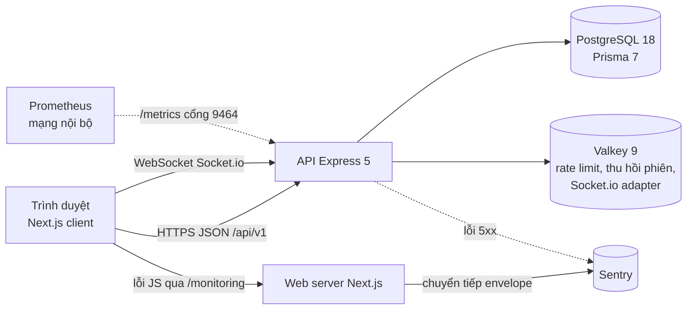
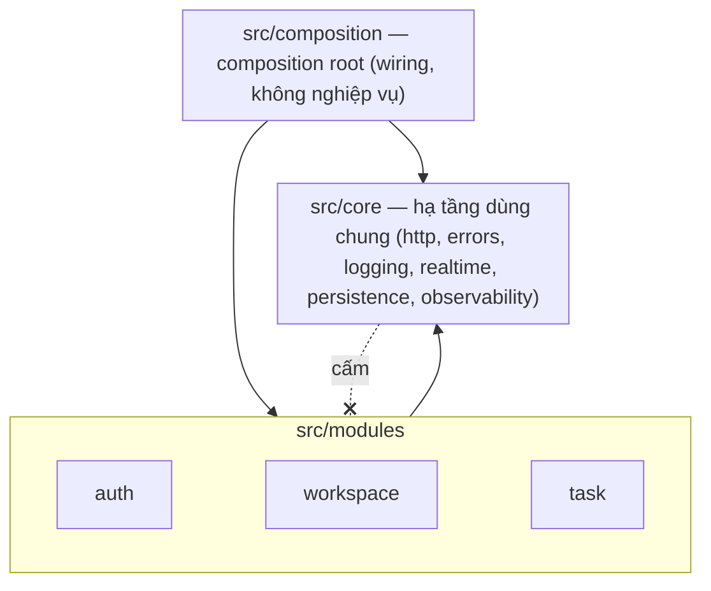
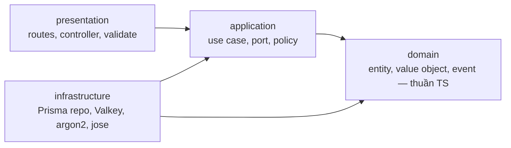
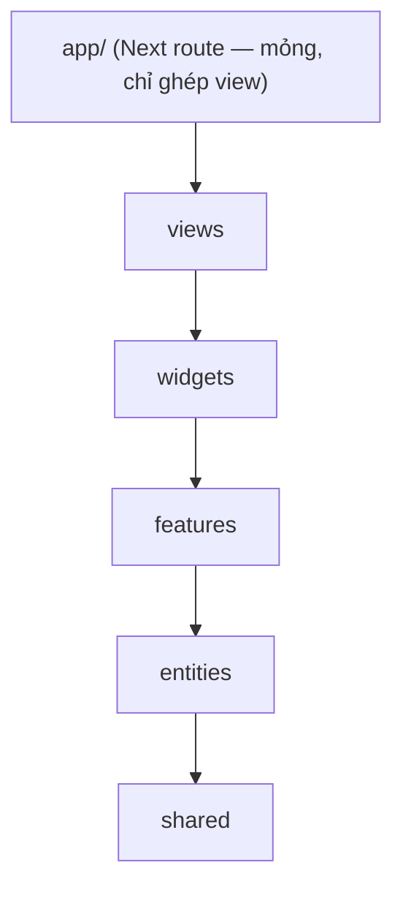

# Kiến trúc TaskFlow — đọc trong 10 phút

Tài liệu "cửa vào": mỗi mục tóm tắt rồi **trỏ tới nguồn chi tiết** (`docs/design/*`, [DECISIONS](blueprint/DECISIONS.md)). Khi hai nơi lệch nhau, DECISIONS + design là chuẩn.

## 1. Bức tranh tổng



- **Monorepo pnpm**: `apps/api`, `apps/web`, `packages/contracts` (Zod — nguồn duy nhất của schema/type/mã lỗi/ma trận quyền), `packages/config` (luật kiến trúc).
- API là **modular monolith** chạy nhiều instance (ADR-000): trạng thái chung nằm ở Postgres/Valkey, realtime giữa instance qua Socket.io redis-adapter.

## 2. Backend: module + Clean Architecture



Mỗi module chia 4 tầng; mũi tên là hướng phụ thuộc **được phép**:



Luật do **máy ép** (vi phạm ⇒ `pnpm lint` đỏ; mỗi luật có fixture + test trong `packages/config/test`) — ADR-004:

| Luật (dependency-cruiser `packages/config/depcruise/api.cjs`) | Nghĩa |
|---|---|
| `domain-is-pure` | domain không import application/infrastructure; ESLint cấm Prisma/Express/Valkey/Socket.io/Zod/jose trong domain |
| `application-no-infra` | use case chỉ biết **port** (interface), không biết Prisma |
| `module-public-api-only` | module chỉ dùng module khác qua `modules/<x>/index.ts`; phụ thuộc chéo đảo ngược bằng port (ADR-093, vd Workspace định nghĩa `ITaskAssignmentCleaner`, Task hiện thực) |
| `core-no-modules` | `core` không biết module nào |
| `no-circular` | không vòng lặp |

Wiring tập trung ở `src/composition` + `*.module.ts` (ADR-016, không singleton nghiệp vụ). Chỉ `src/config/env.ts` đọc `process.env`. Chi tiết: [data-and-api.md](design/data-and-api.md).

## 3. Luồng một request: kéo thả task

`PATCH /api/v1/workspaces/:wsId/projects/:projectId/tasks/:taskId/move` với `{ status, beforeId?, afterId?, expectedVersion }`:

```mermaid
sequenceDiagram
  autonumber
  participant C as Client (board)
  participant H as Express middleware
  participant U as MoveTask use case
  participant DB as UoW / Prisma (1 transaction)
  participant R as Realtime gateway
  C->>H: PATCH …/move (Bearer, X-Client-Id)
  H->>H: rate limit · authenticate (JWT + tv/sid đã thu hồi?) · validate params
  H->>H: thành viên ws? (không ⇒ 404) · project/task ∈ ws? (404) · body / quyền (400 / 403)
  H->>U: execute(scope, body)
  U->>DB: begin · khóa cột (project, status) · đọc task
  U->>U: Policy (403) · chuyển trạng thái hợp lệ? (422) · version khớp? (409 + bản hiện tại)
  U->>U: tính rank mới từ hàng xóm (fractional index) — hết chỗ ⇒ rebalance cột
  U->>DB: UPDATE … WHERE id AND version = expected (count 0 ⇒ 409) · INSERT audit log
  DB-->>U: commit
  U-->>H: TaskDto (version + 1)
  H-->>C: 200
  U->>R: afterCommit ⇒ emit task:moved tới phòng project:{id}
  R-->>C: task:moved (client khác cập nhật; client gốc bỏ qua theo originClientId)
```

Điểm cốt lõi:
- **Thứ tự lỗi** cố định 401 → 400 params → 404 → 403 → 400 body → 422 → 409 (security.md): người ngoài không phân biệt được "không tồn tại" và "không có quyền" (chống IDOR — ADR-020).
- **Optimistic lock** mọi aggregate ghi đồng thời: `UPDATE … WHERE version = expected`, lệch ⇒ `409 VERSION_CONFLICT` kèm bản hiện tại để FE hòa giải không cần tải lại (ADR-010, nguyên tắc chung ADR-110).
- **Rank** là chuỗi fractional-indexing (ADR-011); cột hết khoảng trống ⇒ rebalance trong cùng transaction, dưới khóa cột (T-033).
- **Audit trong cùng transaction**; **phát realtime SAU commit** — rollback thì không ai nhận event "ma" (ADR-012).

## 4. Xác thực và phiên

- Access token JWT 15 phút (jose, HS256, xoay khóa theo `kid`) trong bộ nhớ trình duyệt — không localStorage (ADR-026).
- Refresh token **xoay vòng mỗi lần dùng**, DB là nguồn sự thật, dùng lại token cũ ⇒ thu hồi cả "family" (ADR-024). Cookie `__Host-tf_rt; Secure; HttpOnly; SameSite=Strict; Path=/` ở staging/production (ADR-109).
- **Thu hồi fail-closed**: logout / logout-all / đổi mật khẩu ghi dấu thu hồi vào Valkey **trước** commit; Valkey lỗi ⇒ thao tác lỗi, không âm thầm bỏ qua (ADR-105). Socket đang mở bị ngắt ngay.
- Rate limit theo IP / user / email (login theo ADR-108: chỉ đếm sai mật khẩu, không cho khóa tài khoản người khác từ xa).

Chi tiết: [security.md](design/security.md).

## 5. Frontend: Feature-Sliced Design



- Chỉ phụ thuộc **xuống**, không chéo slice cùng tầng, chỉ qua `index.ts` của slice (dependency-cruiser `web.cjs`).
- Gọi mạng chỉ qua `shared/api` (ESLint cấm `fetch` chỗ khác); server state bằng TanStack Query, kéo thả bằng dnd-kit với **cập nhật lạc quan** + hòa giải khi `409`.
- Realtime: event ghép vào cache theo `version` (bản cũ hơn bị bỏ), không refetch cả bảng.
- CSP có nonce mỗi request + `strict-dynamic`, không `unsafe-inline/eval` ở production. Sentry trình duyệt đi qua tunnel cùng origin `/monitoring` nên CSP không phải mở thêm.

Chi tiết: [frontend.md](design/frontend.md).

## 6. Realtime

- Socket.io chỉ websocket; xác thực token ở handshake, kiểm Origin; phòng `user:{id}`, `session:{sid}`, `project:{id}`.
- Vào phòng project phải qua kiểm quyền (kiểm lại sau khi join — chống TOCTOU); thu hồi quyền ⇒ server đẩy socket ra.
- Kênh **một chiều** server → client: mọi thay đổi đi qua HTTP (có validate, quyền, audit), socket chỉ báo tin.
- Nhiều instance: redis-adapter trên Valkey; Valkey lỗi ⇒ instance hiện tại vẫn thu hồi cục bộ, process không sập (T-030).

## 7. Quan sát được (observability)

- Log JSON (pino) có `reqId` + `ip` mọi dòng; serializer lỗi **theo danh sách cho phép** — lỗi DB không mang email/hash ra log (T-031).
- Sentry API + web dùng cùng nguyên tắc allow-list; `/metrics` Prometheus ở cổng nội bộ riêng (T-035).
- Cảnh báo email + uptime: [runbook/alerts.md](runbook/alerts.md).

## 8. Quyết định quan trọng nhất (đọc ADR để biết lý do)

| Chủ đề | ADR |
|---|---|
| Luật kiến trúc do máy ép | ADR-004 |
| Optimistic lock / cấm ghi snapshot không kiểm soát | ADR-010, ADR-104, ADR-110 |
| Rank fractional-indexing (+ rebalance — T-033) | ADR-011 |
| Audit trong transaction, realtime sau commit | ADR-012 |
| Chống IDOR bằng route lồng + kiểm 2 lớp | ADR-020 |
| Refresh token xoay vòng, cookie `__Host-` | ADR-024, ADR-109 |
| Thu hồi phiên fail-closed | ADR-105 |
| Repo public: gitleaks, không secret | ADR-072 |
| Máy dev: giảm tải bằng quy trình | ADR-107 |
| Threat model STRIDE v1 + rủi ro chấp nhận có chủ đích | [design/threat-model.md](design/threat-model.md), ADR-113 |
