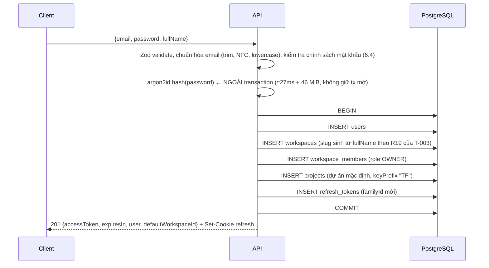
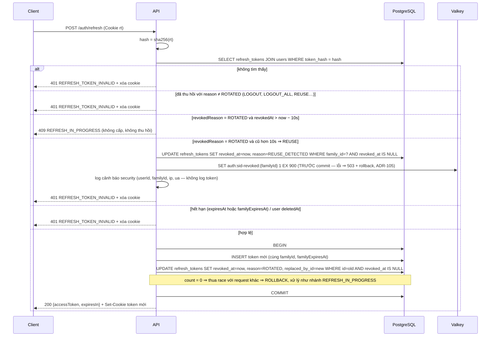

# Thiết kế bảo mật — Auth, phân quyền, đa tenant (T-002)

**Tác giả:** Engineer B (`taskflow-enterprise-87`) · **Phase:** 0 · **Trạng thái:** ✅ chính thức (ADR-040) · đã cập nhật theo ADR-041 → ADR-093 (T-002c)
**Căn cứ:** `DECISIONS.md` v1.1 (ADR-014, ADR-020 → ADR-030), PRD v1.0 mục 1.2 & 6. Thống nhất cột DB + mã lỗi với Engineer C (T-003).

> Quy ước: "phải/không được" = bắt buộc khi code ở Phase 2–3. Phiên bản thư viện cụ thể do T-001 (`docs/research/stack-versions.md`) chốt; tài liệu này chỉ mô tả hành vi.

---

## 0. Mô hình mối đe dọa (tóm tắt)

> Threat model **đầy đủ** (STRIDE theo thành phần, biên tin cậy, tác nhân, cách mỗi biện pháp được kiểm chứng tự động, và **danh sách rủi ro chấp nhận có chủ đích kèm ADR**): [`threat-model.md`](threat-model.md). Bảng dưới chỉ là tóm tắt.

| Tài sản | Mối đe dọa chính | Lớp phòng thủ |
|---|---|---|
| Dữ liệu workspace khác | IDOR (đoán / đổi id trong URL, cursor, socket) | Route lồng + membership + query có phạm vi tenant + 404 đồng nhất (mục 4); cursor gắn `kind`, id phải uuid |
| Phiên người dùng | Trộm refresh token; cookie tossing từ subdomain anh em | Rotation + phát hiện reuse + thu hồi family (1.4); cookie `__Host-` (2.3, ADR-109) |
| Thu hồi phiên | Lost update, Valkey mất dữ liệu / lỗi khi ghi | Lệnh nguyên tử (ADR-104); ghi thu hồi trước commit, fail-closed (ADR-105); cache miss kiểm DB + khôi phục `sid-revoked` (2.4) |
| Access token | XSS đọc bộ nhớ JS | TTL 15 phút, `tv` / `sid` thu hồi được, CSP nonce ở web (6.8) |
| Mật khẩu | Brute force, credential stuffing, rò DB | argon2id (ADR-065), rate limit đa khóa chống khóa tài khoản (6.4, ADR-108), chặn mật khẩu phổ biến |
| Quyền | Leo thang; request đang bay của người vừa bị hạ quyền | Role tối thiểu + Policy (mục 3); đọc lại role trong transaction (3.5) |
| Toàn vẹn dữ liệu | Ghi đồng thời làm hồi sinh / gỡ archive | Optimistic lock `version` (ADR-110) |
| Log / Sentry | Rò email, hash, token, dòng DB | Serializer allow-list, redact, Sentry `dataCollection` tắt + `beforeSend` allow-list |
| Bản sao lưu | Lộ, bị xóa, không khôi phục được | age phía client, credential PutObject-only, diễn tập khôi phục hằng tuần (`docs/runbook/backup-restore.md`) |
| Mã nguồn công khai (ADR-072) | Lộ secret qua git | gitleaks pre-commit + CI toàn lịch sử, push protection (6.9) |
| Endpoint dùng cookie | CSRF | SameSite=Strict + kiểm `Origin` + bắt buộc `application/json` |

---

## 1. Luồng xác thực

### 1.1 Register — `POST /api/v1/auth/register` (Public)



- **Trùng email:** bắt lỗi unique (Prisma `P2002`, target `email`) → rollback → `409 EMAIL_ALREADY_EXISTS`. Không kiểm tra "SELECT trước rồi INSERT" (race).
- **Slug (R19, `data-and-api.md` 2.5):** sinh từ `fullName` (bỏ dấu, `đ→d`, ký tự lạ thành `-`, cắt 40 ký tự); dưới 3 ký tự hoặc trùng slug dành riêng ⇒ `workspace-xxxxxx`. Trùng (`P2002` target `slug`) ⇒ thêm hậu tố ngẫu nhiên 6 ký tự, **thử lại cả transaction tối đa 5 lần** (lỗi unique làm hỏng transaction Postgres nên không thể thử lại bên trong), sau đó `500 INTERNAL_ERROR`. Slug không bao giờ lấy từ email (lộ email qua URL). Slug chỉ để hiển thị; mọi route dùng `wsId` (uuid), nên đoán slug không giúp truy cập.
- Register tự đăng nhập (tạo family mới như login).
- Anti-enumeration cho register: xem 6.5 (v1 chấp nhận lộ email đã đăng ký, ADR-049).

### 1.2 Login — `POST /api/v1/auth/login` (Public)

1. Rate limit (6.4) **trước** mọi thao tác DB/băm mật khẩu.
2. Zod validate; chuẩn hóa email.
3. `findUnique({ email })`. Nếu **không có** hoặc `deletedAt != null` → vẫn chạy `verify(DUMMY_HASH, password)` (DUMMY_HASH tạo lúc khởi động bằng **cùng tham số argon2id**, không commit vào repo) để thời gian phản hồi tương đương, rồi `401 INVALID_CREDENTIALS`.
4. `verify` sai → `401 INVALID_CREDENTIALS` (cùng message: "Email hoặc mật khẩu không đúng").
5. Đúng → nếu tham số trong chuỗi PHC của hash (`m`, `t`, `p`) khác cấu hình hiện tại thì băm lại và cập nhật (đổi tham số về sau không cần reset mật khẩu). Adapter dùng `parseOptions(hash)` của `@node-rs/argon2` (đã kiểm chứng ở bản 2.2.2, T-013) rồi so `algorithm`, `version`, `memoryCost`, `timeCost`, `parallelism`, `outputLen` với cấu hình; hash không đọc được ⇒ coi như cần băm lại.
6. Tạo refresh token (family mới, `familyExpiresAt = now + 30 ngày`), cập nhật `lastLoginAt`, ký access token với `tv = user.tokenVersion`, `sid = familyId`.
7. `200 {accessToken, expiresIn, user}` + `Set-Cookie`.

Không có khóa tài khoản cứng (attacker có thể khóa nạn nhân = DoS); dùng rate limit theo email + IP.

### 1.3 Đặc tả lưu trữ phiên (refresh token family)

- **Family** = một phiên đăng nhập trên một thiết bị. `familyId` tạo ở login/register, giữ nguyên khi xoay.
- Mỗi token chỉ dùng **1 lần**. Hạn trượt 7 ngày (`expiresAt = min(now + 7d, familyExpiresAt)`), hạn tuyệt đối 30 ngày (`familyExpiresAt`) — sau 30 ngày phải đăng nhập lại dù hoạt động liên tục.

### 1.4 Refresh rotation + phát hiện reuse — `POST /api/v1/auth/refresh`

Yêu cầu: cookie refresh + `Origin` thuộc whitelist (nếu không → `403 ORIGIN_NOT_ALLOWED`). Không body.



- **Cập nhật có điều kiện** (`updateMany … where revokedAt: null` rồi kiểm `count`) là chốt chặn race: hai request mang cùng token chỉ một cái thắng.
- **Cửa sổ ân hạn 10s** chống báo động giả khi 2 tab refresh đồng thời. Trong cửa sổ đó kẻ trộm cũng **không nhận được token** — chỉ không kích hoạt thu hồi. Phía FE bắt buộc single-flight refresh xuyên tab (Web Locks API `navigator.locks.request('tf-refresh', …)`), nhận `409 REFRESH_IN_PROGRESS` thì đợi ~300ms và thử lại **1 lần** (cookie mới đã nằm trong jar).
- `REFRESH_TOKEN_INVALID` dùng chung cho mọi thất bại (không tiết lộ đã phát hiện reuse).
- Access token mới luôn đọc `tokenVersion` hiện tại từ DB (đã JOIN users).

### 1.5 Logout 1 thiết bị — `POST /api/v1/auth/logout`

Cookie + kiểm tra `Origin`. Không cần access token (có thể đã hết hạn). **Luôn `204`** (idempotent), luôn xóa cookie.
1. Có cookie và tìm thấy token → thu hồi **cả family** (`reason = LOGOUT`, chỉ các dòng `revokedAt IS NULL`).
2. **Trong transaction, TRƯỚC commit** (ADR-105): `SET auth:sid-revoked:{familyId} 1 EX 900` → access token đang lưu hành của phiên này chết ngay (không đợi 15 phút). Ghi lỗi ⇒ `503 SERVICE_UNAVAILABLE` + rollback (family **không** bị thu hồi nửa vời; client thử lại). Sau commit ghi lại lần nữa (best-effort).
3. Socket: `io.in('session:{familyId}').disconnectSockets(true)`.

### 1.6 Logout mọi thiết bị — `POST /api/v1/auth/logout-all` (Bearer)

1. Transaction: `UPDATE users SET token_version = token_version + 1 … RETURNING token_version` (lệnh nguyên tử — ADR-104, không đọc-rồi-ghi cả aggregate); thu hồi mọi refresh token còn sống của user (`reason = LOGOUT_ALL`).
2. **Vẫn trong transaction, TRƯỚC commit** (ADR-105): `SET auth:tv:{userId} <newTv> EX 60` (ghi đè vô điều kiện; `newTv` lấy từ `RETURNING`). Ghi lỗi ⇒ `503` + rollback. Sau commit ghi lại lần nữa (best-effort) — xem 2.4.
3. `io.in('user:{userId}').disconnectSockets(true)`.
4. `204` + xóa cookie. Mọi access token có `tv` cũ bị từ chối ngay ở request kế tiếp (`401 UNAUTHORIZED`).

### 1.7 Đổi mật khẩu — `POST /api/v1/auth/change-password` (Bearer)

Body `{ currentPassword, newPassword }`. Rate limit 5/15 phút/user.
1. `verify(currentPassword)` sai → `400 INVALID_CURRENT_PASSWORD` (cố ý không dùng 401 để interceptor FE không nhầm là hết hạn token).
2. `newPassword` qua chính sách 6.4 và phải khác mật khẩu cũ.
3. Hash mới ngoài transaction. Transaction: **một câu lệnh có điều kiện** (ADR-104) `UPDATE users SET password_hash = $new, password_changed_at = now, token_version = token_version + 1 WHERE id = $id AND password_hash = $hashVừaVerify AND deleted_at IS NULL RETURNING token_version`. Không khớp dòng nào (mật khẩu vừa bị đổi ở request khác) ⇒ `400 INVALID_CURRENT_PASSWORD`, không đổi gì. Rồi thu hồi **mọi** refresh token (`reason = PASSWORD_CHANGED`); tạo family mới cho thiết bị hiện tại, ký access token bằng `tv` mới từ `RETURNING`.
4. **Trước commit** (ADR-105): `SET auth:tv:{userId} <newTv> EX 60`; lỗi ⇒ `503` + rollback (mật khẩu cũ vẫn hiệu lực). Sau commit: ghi lại (best-effort), ngắt mọi socket của user (`user:{userId}`) — tab hiện tại tự kết nối lại bằng token mới.
5. `200 {accessToken, expiresIn}` + Set-Cookie mới.

**Phải thu hồi:** mọi refresh token, mọi access token (qua `tv`), mọi socket. Lý do: đổi mật khẩu thường là phản ứng khi nghi bị lộ.

### 1.8 `GET` / `PATCH /api/v1/auth/me` (Bearer)
- `GET`: trả `{ user: {id, email, fullName}, memberships: [{workspaceId, workspaceName, slug, role}] }`. Lọc theo `req.user.id`, không nhận tham số id.
- `PATCH` (ADR-083): body **strict** `{ fullName }` (trim, 1–100 ký tự, không ký tự điều khiển). Chỉ sửa user của chính token (`req.user.id`) — không có tham số id nên không có đường IDOR. **Không** đổi được `email`, mật khẩu, `tokenVersion` hay bất kỳ trường nào khác qua endpoint này (field lạ ⇒ `400`). Rate limit 30/giờ/user. Không thu hồi phiên.

### 1.9 Ngoài phạm vi v1 (ghi nhận)
Quên mật khẩu / xác minh email (cần hạ tầng email), MFA, danh sách & thu hồi từng phiên trên UI (schema đã đủ dữ liệu để làm sau: `userAgent`, `ip`, `familyId`).

---

## 2. Đặc tả token

### 2.1 Access token (JWT)

| Mục | Giá trị |
|---|---|
| Thuật toán | **HS256** (một service vừa ký vừa xác minh, không cần khóa công khai). Thư viện **jose 6** (ADR-060): ký bằng `new SignJWT(claims).setProtectedHeader({ alg: 'HS256', kid })`, verify bằng `jwtVerify(token, key, { algorithms: ['HS256'], issuer, audience, clockTolerance: 5 })` — **phải** truyền whitelist `algorithms` (chống `alg: none` / nhầm thuật toán). Khóa = `new TextEncoder().encode(secret)`. |
| Khóa | `JWT_ACCESS_SECRET` ≥ 32 byte ngẫu nhiên (base64), kiểm tra độ dài bằng Zod lúc khởi động; dev và prod khác nhau. Header có `kid`; env cho phép `JWT_ACCESS_SECRET_PREVIOUS` để xoay khóa không làm rớt phiên (verify thử theo `kid`). |
| TTL | 15 phút (`expiresIn: 900` trong response). `clockTolerance` 5s. Riêng `APP_ENV=test`: `JWT_ACCESS_TTL_SECONDS` (5–900) rút ngắn TTL cho test hết hạn hộp đen (T-031); đặt biến này ở môi trường khác ⇒ app từ chối khởi động. |
| Lưu trữ FE | Chỉ trong bộ nhớ (ADR-026). Gửi bằng `Authorization: Bearer`. Không bao giờ ở localStorage/cookie/URL. |

Claims:

| Claim | Ý nghĩa |
|---|---|
| `sub` | userId (uuid) |
| `tv` | `users.token_version` lúc ký (ADR-025) |
| `sid` | `familyId` của phiên — cho logout 1 thiết bị & room socket `session:{sid}` |
| `jti` | uuid ngẫu nhiên (truy vết log) |
| `iat`, `exp` | chuẩn |
| `iss` | `taskflow-api` |
| `aud` | `taskflow-web` |

**Không** có `role`, `workspaceId`, `email` trong JWT: role theo workspace và đổi được bất kỳ lúc nào → luôn đọc từ DB mỗi request (xem 3.3).

> `JWT_REFRESH_SECRET` trong `.env` v1.0 **không còn cần**: refresh token là chuỗi ngẫu nhiên mờ (opaque), không phải JWT. Đề xuất bỏ khỏi `.env.example` ở Phase 1.

### 2.2 Refresh token

| Mục | Giá trị |
|---|---|
| Sinh | `crypto.randomBytes(32)` → base64url (43 ký tự), 256 bit entropy |
| Lưu DB | `tokenHash = sha256(token)` dạng hex (64 ký tự), `@unique`. SHA-256 (không dùng hàm băm mật khẩu chậm như argon2) vì token đã có entropy cao và cần tra cứu theo hash (ADR-024). So khớp bằng tra cứu index nên không có vấn đề timing. |
| Hạn | Trượt 7 ngày, tuyệt đối 30 ngày (1.3) |
| Dọn dẹp | Job hằng ngày (`purge-expired-refresh-tokens`, G2 S2) xóa dòng có **`familyExpiresAt < now − 7 ngày`**: giữ 7 ngày sau khi **cả phiên** hết hạn tuyệt đối để điều tra. Không xóa theo `expiresAt` từng token: token đã xoay vẫn phải còn để **phát hiện reuse** trong suốt đời phiên (tới 30 ngày). ⇒ Một dòng (kèm `ip`, `user_agent`) sống tối đa ≈ 37 ngày. Lô 5 000 dòng/transaction, ≤ 20 lô/lượt, khóa advisory một instance (`taskflow:refresh-token-purge`) |

### 2.3 Cookie

| Thuộc tính | Production | Development (localhost, HTTP) |
|---|---|---|
| Tên | `__Host-tf_rt` (ADR-109) | `tf_rt` |
| `HttpOnly` | ✅ | ✅ |
| `Secure` | ✅ | ❌ |
| `SameSite` | `Strict` | `Strict` (`localhost:3000` và `localhost:4000` cùng site — cổng không tính) |
| `Path` | `/` (tiền tố `__Host-` bắt buộc) | `/api/v1/auth` (trên localhost cookie không tách theo cổng — Path hẹp để không gửi sang web `:3000`) |
| `Domain` | **không đặt** (host-only trên `api.example.com`) | không đặt |
| `Max-Age` | = thời gian còn lại tới `expiresAt` | như prod |

- **ADR-109 (ghi đè thuộc tính cookie của ADR-024): tiền tố `__Host-`** ở staging/production.
  - `__Secure-` không cấm `Domain=` ⇒ subdomain anh em (`*.example.com` bị XSS / takeover) cài được `__Secure-tf_rt; Domain=example.com` ⇒ cookie tossing / login CSRF (T-028, F + B).
  - `__Host-` buộc trình duyệt **từ chối** mọi cookie tên này có `Domain=`, thiếu `Secure` hoặc `Path` ≠ `/`.
  - Server **chỉ đọc đúng tên `__Host-tf_rt`** ở prod. Cookie `tf_rt` / `__Secure-tf_rt` do ai khác đặt bị bỏ qua ⇒ `401 REFRESH_TOKEN_INVALID`.
  - Đánh đổi `Path=/` được chấp nhận: cookie đi kèm mọi request tới **API origin riêng** (`api.example.com`), vẫn HttpOnly + SameSite=Strict. Header `Cookie` / `Set-Cookie` đã redact trong log (`REDACT_PATHS`, access log không ghi header). Route ngoài `/auth/{refresh,logout}` dùng Bearer, không đọc cookie.
- **Nhiều cookie trùng tên** (chỉ có thể do bên thứ ba cài; lớp phòng thủ thứ hai sau `__Host-`) ⇒ `/auth/refresh` và `/auth/logout` **thu hồi family của MỌI giá trị** (như logout) rồi `401` / `204` + xóa cookie: cookie còn sót lại trong trình duyệt đều đã chết, không thể hoán đổi phiên.
  - Quá **4** giá trị ⇒ `401` ngay, không thu hồi từng cái (chặn khuếch đại DB/Valkey) và **không** xóa cookie.
  - Cái giá khi đang bị tấn công: nạn nhân phải đăng nhập lại.
- Dev tắt `Secure` vì: Chrome nhận `Secure` trên localhost nhưng **từ chối tiền tố `__Secure-`/`__Host-`**, Safari từ chối cookie `Secure` trên localhost hoàn toàn. Cấu hình bằng `COOKIE_SECURE` + `COOKIE_NAME` suy ra từ `NODE_ENV`; **app không khởi động** nếu `NODE_ENV=production` mà `COOKIE_SECURE=false`.
- Xóa cookie: `Set-Cookie` cùng tên/Path với `Max-Age=0`.
- FE gọi các endpoint `/auth/*` với `credentials: 'include'`.

### 2.4 Valkey (ADR-063)

Valkey (giấy phép BSD) thay Redis, client `node-redis` 6 (ADR-060). Tên key và hành vi không đổi; trong tài liệu này "cache" = Valkey.

| Key | Giá trị | TTL | Ghi bởi | Đọc bởi |
|---|---|---|---|---|
| `auth:tv:{userId}` | token_version (int) | **60s** (ADR-105) | logout-all, đổi mật khẩu, xóa user: `SET … EX 60` (vô điều kiện) **TRƯỚC commit**, rồi ghi lại sau commit. Đọc miss (read-through): load DB rồi **chỉ** `SET … EX 60 NX` | middleware HTTP + socket |
| `auth:sid-revoked:{familyId}` | `1` | 905s (= TTL access token 900s + `clockTolerance` 5s của jose — T-032) | logout, reuse detected — **TRƯỚC commit**, rồi ghi lại sau commit | middleware HTTP + socket |
| `rl:{rule}:{key}` | bộ đếm | theo cửa sổ | rate-limit store | rate-limit |

- **Thu hồi fail-closed (ADR-105, finding A3 của QA):** giá trị thu hồi (`tv` mới, `sid-revoked`) được ghi vào Valkey **bên trong transaction, trước commit**. Ghi lỗi ⇒ `503 SERVICE_UNAVAILABLE` và rollback — không bao giờ có trạng thái "DB đã thu hồi nhưng cache vẫn cho token cũ qua". Sau commit ghi lại lần nữa (best-effort, chỉ log cảnh báo nếu lỗi).
  - Ghi trước commit nhưng transaction lại rollback ⇒ cache tạm "thu hồi quá tay" (token hợp lệ bị 401 tối đa 60s / 900s): chấp nhận được vì là hướng **an toàn**.
  - **Không dùng "DEL trước commit"**: request đọc xen giữa (cache miss) sẽ nạp lại `tv` CŨ từ DB chưa commit, và giá trị cũ đó sống tới hết TTL.
- Writer `SET` vô điều kiện còn reader `SET NX`: read-through **không bao giờ** đè giá trị writer đã đặt; writer ghi lại sau commit đè mọi giá trị cũ còn sót. TTL `auth:tv` ngắn (60s) giới hạn thời gian một giá trị cũ có thể sống trong trường hợp xấu nhất.
- Middleware gọi `MGET auth:tv:{sub} auth:sid-revoked:{sid}` — **1 round-trip** mỗi request.
- **Cache miss = có thể Valkey vừa mất dữ liệu (X3, T-032).** Valkey không persistence ⇒ restart xóa mọi `auth:sid-revoked:*`. Vì vậy **thiếu khóa `sid-revoked` không có nghĩa là phiên còn sống**:
  - Miss `auth:tv` ⇒ đọc **cả** `token_version` lẫn "phiên đã LOGOUT / REUSE_DETECTED" trong DB.
  - Trước khi `SET NX` lại `tv`, khôi phục `sid-revoked` của mọi phiên của user bị thu hồi trong 900s gần nhất, với TTL = phần còn lại của cửa sổ. Khi đã trúng cache `tv`, request không hỏi DB về `sid` nữa, nên phải khôi phục `sid-revoked` trước; nếu không, một phiên đã đăng xuất khác của cùng user sẽ lọt qua.
  - Khôi phục lỗi ⇒ **không** nạp `tv` ⇒ lần sau vẫn miss và hỏi DB (fail-closed).
- **Valkey lỗi:** `tv` fallback đọc DB (ADR-025); `sid-revoked` fallback `SELECT 1 FROM refresh_tokens WHERE family_id = $sid AND revoked_reason IN ('LOGOUT','REUSE_DETECTED') LIMIT 1` (dùng index `family_id`). DB cũng lỗi → `503 SERVICE_UNAVAILABLE` (fail-closed). Log cảnh báo khi đang ở chế độ fallback.
- Email trong key rate-limit được băm SHA-256 (không lưu email thô trong Valkey).

### 2.5 Middleware `authenticate`

1. Lấy `Authorization: Bearer <jwt>`; thiếu → `401 UNAUTHORIZED`.
2. Verify chữ ký/alg/iss/aud/exp. Hết hạn → `401 TOKEN_EXPIRED` (FE **chỉ** tự refresh với code này); lỗi khác → `401 UNAUTHORIZED`.
3. `MGET` Valkey (2.4): `tv` khác claim hoặc `sid` bị thu hồi → `401 UNAUTHORIZED`.
4. Gắn `req.user = { id, sid, tv }` (kiểu khai báo bằng module augmentation, ADR-014, cấm `as any`).

---

## 3. Mô hình phân quyền

### 3.1 Role và hạng

`OWNER (4) > PM (3) > MEMBER (2) > VIEWER (1)`. Role là thuộc tính của **membership** (user × workspace), không phải của user.

### 3.2 Danh mục permission (từ ma trận RBAC 1.2)

| Permission | OWNER | PM | MEMBER | VIEWER | Ràng buộc Policy |
|---|:-:|:-:|:-:|:-:|---|
| `workspace:read` | ✅ | ✅ | ✅ | ✅ | |
| `workspace:update` | ✅ | | | | |
| `workspace:delete` | ✅ | | | | Xóa mềm 30 ngày (ADR-047, 3.6) |
| `workspace:restore` | ✅ | | | | ADR-050. Chỉ trên ws đã xóa mềm, chưa quá hạn; middleware riêng `includeDeleted` (3.6) |
| `member:read` | ✅ | ✅ | ✅ | ✅ | |
| `member:add` | ✅ | ✅ | | | PM chỉ thêm với role `MEMBER`/`VIEWER`; OWNER thêm role bất kỳ. Người được thêm phải là user tồn tại, chưa là member. |
| `member:update-role` | ✅ | | | | Không được hạ OWNER cuối cùng (`422 BUSINESS_RULE_VIOLATION`, `details.rule = "LAST_OWNER"`, chống race theo 3.5). Hạ xuống VIEWER ⇒ bỏ gán task (3.5) |
| `member:remove` | ✅ | ✅ | | | PM chỉ xóa `MEMBER`/`VIEWER`; OWNER xóa bất kỳ trừ OWNER cuối cùng |
| `member:leave` (tự rời) | ✅ | ✅ | ✅ | ✅ | Trừ OWNER cuối cùng |
| `project:read` | ✅ | ✅ | ✅ | ✅ | |
| `project:create` | ✅ | ✅ | | | |
| `project:update` | ✅ | ✅ | | | |
| `project:archive` (gồm unarchive) | ✅ | ✅ | | | |
| `task:read` | ✅ | ✅ | ✅ | ✅ | |
| `task:create` | ✅ | ✅ | ✅ | | Project không archived (ADR-023) |
| `task:update` | ✅ | ✅ | ✅ | | Task bất kỳ trong project; project không archived |
| `task:move` | ✅ | ✅ | ✅ | | Task bất kỳ; project không archived |
| `task:assign:any` | ✅ | ✅ | | | Assignee phải là member workspace với role **≥ MEMBER** (ADR-023, ADR-044) |
| `task:assign:own` | | | ✅ | | Chỉ khi (a) task do mình tạo, hoặc (b) tự nhận task chưa có assignee / tự bỏ nhận task đang gán cho mình. Khi **tạo** task: MEMBER chỉ được để trống `assigneeId` hoặc gán cho chính mình; gán cho người khác cần `task:assign:any` (chốt với C, R7 T-003) |
| `task:delete:any` | ✅ | ✅ | | | |
| `task:delete:own` | | | ✅ | | `task.createdById === actor.userId`; `createdById = null` ⇒ chỉ `:any` |
| *(mọi `task:delete:*`)* | | | | | Project archived ⇒ cấm xóa (`422 PROJECT_ARCHIVED`, ADR-045). Task đã xóa mềm ⇒ `404` (ADR-042) |
| `audit:read` | ✅ | ✅ | ✅ | ✅ | |
| `comment:create` | ✅ | ✅ | ✅ | | Dự phòng, chưa có model |

Không có xóa cứng project ở v1. Giả định cần Tech Lead xác nhận: MEMBER được **sửa nội dung** task của người khác (ma trận không nói rõ), và quy tắc `task:assign:own`.

Hằng số `ROLE_PERMISSIONS: Record<WorkspaceRole, ReadonlySet<Permission>>` sống ở tầng **domain** (thuần TS, không import hạ tầng). Kiểu `Permission` là union literal để sai chính tả là lỗi biên dịch.

### 3.3 Hai lớp kiểm tra (ADR-021)

**Lớp 1 — middleware (chặn sớm, rẻ):**
```
router.use('/workspaces/:wsId', authenticate, loadMembership)
  loadMembership: SELECT m.role FROM workspace_members m JOIN workspaces w ON w.id = m.workspace_id
                  WHERE m.workspace_id = :wsId AND m.user_id = req.user.id AND w.deleted_at IS NULL
                  không có dòng ⇒ 404 RESOURCE_NOT_FOUND   (ws không tồn tại, đã xóa mềm, hoặc không phải member — cùng một body)
                  có ⇒ req.membership = { workspaceId, role }
requirePermission('task:delete')  // thỏa nếu role có :any HOẶC :own ⇒ MEMBER qua, VIEWER bị 403
```
- Membership **đọc DB mỗi request** (lookup trên unique `[workspaceId, userId]`, rẻ), không cache ở v1, để đổi role/xóa member có hiệu lực ngay. Nếu sau này cache thì phải invalidation tường minh khi đổi role/xóa member.
- Router con phải tạo với `Router({ mergeParams: true })`, nếu không `:wsId` sẽ mất.

**Lớp 2 — Policy ở application (quyết định cuối):**
```ts
// application/policies/task.policy.ts  (phác thảo, không phải code cuối)
canDelete(actor: Actor, task: TaskSnapshot): boolean {
  if (actor.has('task:delete:any')) return true;
  return actor.has('task:delete:own') && task.createdById === actor.userId;
}
```
- `Actor = { userId, workspaceId, role }` do controller dựng từ `req.user` + `req.membership` và truyền vào UseCase. UseCase **không** đọc `req`.
- Policy từ chối → `ForbiddenError` (`403 FORBIDDEN_ACCESS`).
- Mỗi aggregate một Policy: `WorkspacePolicy`, `MemberPolicy`, `ProjectPolicy`, `TaskPolicy`. Unit test bảng (role × tình huống) cho từng Policy.

### 3.4 Endpoint → permission

Tiền tố `/api/v1`. `ws` = `/workspaces/:wsId`, `p` = `/projects/:projectId`, `t` = `/tasks/:taskId`.

| Endpoint | Middleware (min) | Policy thêm |
|---|---|---|
| `POST /auth/register`, `/auth/login` | Public + rate limit | |
| `POST /auth/refresh`, `/auth/logout` | Cookie + Origin + rate limit | |
| `POST /auth/logout-all`, `/auth/change-password`, `GET /auth/me` | `authenticate` | |
| `PATCH /auth/me` (ADR-083) | `authenticate` | chỉ `fullName`, chỉ chính mình (1.8) |
| `GET /workspaces` (của tôi) | `authenticate` | lọc theo userId, `deleted_at IS NULL`; `?deleted=true` ⇒ chỉ ws đã xóa mà tôi là OWNER |
| `POST /workspaces` | `authenticate` | người tạo thành OWNER (cùng transaction); rate limit 10/giờ/user |
| `GET ws` | `workspace:read` | |
| `PATCH ws` | `workspace:update` | |
| `DELETE ws` | `workspace:delete` | xóa mềm (3.6) |
| `POST ws/restore` (ADR-050) | `requireMembership(includeDeleted, OWNER)` — không qua `loadMembership` | điều kiện `deleted_at IS NOT NULL AND purge_at > now()` (3.6) |
| `GET ws/members` (có `q`, ADR-083) | `member:read` | `q` chỉ tìm trong member của ws này (6.7) |
| `POST ws/members` | `member:add` | role được cấp ≤ quyền người mời |
| `PATCH ws/members/:userId` | `member:update-role` | LAST_OWNER |
| `DELETE ws/members/:userId` | `member:leave` (VIEWER) | Policy: chính mình ⇒ leave; người khác ⇒ cần `member:remove` + luật PM/OWNER + LAST_OWNER |
| `GET ws/projects`, `GET ws/p` | `project:read` | |
| `POST ws/projects` | `project:create` | |
| `PATCH ws/p` | `project:update` | |
| `POST ws/p/archive`, `ws/p/unarchive` | `project:archive` | |
| `GET ws/p/tasks`, `GET ws/p/t` | `task:read` | |
| `POST ws/p/tasks` | `task:create` | không archived; nếu có `assigneeId` ⇒ `canAssign` + assignee là member |
| `PATCH ws/p/t` | `task:update` | không archived, `expectedVersion` |
| `PATCH ws/p/t/move` | `task:move` | không archived, `expectedVersion` |
| `PATCH ws/p/t/assignee` — body `{ expectedVersion, assigneeId: uuid \| null }` | `task:assign:own` (MEMBER) | `canAssign` (any/own), assignee là member, không archived |
| `DELETE ws/p/t` | `task:delete:own` (MEMBER) | `canDelete` |
| `GET ws/p/t/audit-logs` | `audit:read` | |

Đường dẫn chính xác (VD `/move` hay `/status`) theo contract của Engineer C trong `docs/design/data-and-api.md`; bảng permission phải giữ khớp.

---

### 3.5 Luật thành viên chống race (ADR-044, ADR-046)

**LAST_OWNER (ADR-046).** Hạ role, xóa member, tự rời và (sau này) ẩn danh hóa user đều đi qua **một** hàm application `ensureOwnerRemainsAfter(change)` chạy trong transaction:
```sql
-- 1. Khóa mọi dòng OWNER của ws, thứ tự cố định (theo id) để không deadlock giữa 2 transaction
SELECT id, user_id FROM workspace_members
 WHERE workspace_id = $ws AND role = 'OWNER'
 ORDER BY id
 FOR UPDATE;
-- 2. Tính số OWNER còn lại SAU thay đổi; < 1 ⇒ ROLLBACK, 422 BUSINESS_RULE_VIOLATION (LAST_OWNER)
-- 3. Áp thay đổi (UPDATE role / DELETE membership) trong cùng transaction
```
- Kịch bản race: ws có đúng 2 OWNER là Alice và Olga, mỗi người hạ người kia cùng lúc. Transaction thứ hai bị chặn ở bước 1 đến khi transaction thứ nhất commit. Ở mức READ COMMITTED, PostgreSQL đánh giá lại `WHERE role = 'OWNER'` trên phiên bản dòng mới nên chỉ còn đếm được 1 OWNER ⇒ bị từ chối. Kết quả: đúng 1 thành công, 1 nhận `422`, ws luôn còn ≥ 1 OWNER.
- Chỉ các thao tác **giảm** số OWNER mới cần khóa. Thêm OWNER thì không cần.
- Không được thay bằng "đếm rồi kiểm tra" không khóa, và không đặt kiểm tra này trong middleware.

**Assignee ≥ MEMBER (ADR-044).**
- Gán (khi tạo task hoặc `PATCH …/assignee`): trong transaction, đọc membership của assignee bằng `SELECT role … FOR SHARE`, yêu cầu role ∈ {OWNER, PM, MEMBER}. Không thỏa ⇒ `422 BUSINESS_RULE_VIOLATION` (`ASSIGNEE_NOT_MEMBER`), cùng message dù user không tồn tại, không phải member hay là VIEWER (không lộ thông tin).
- Hạ role xuống VIEWER, hoặc xóa / tự rời: trong **cùng transaction** với việc đổi role/xóa membership (dòng membership đã bị `FOR UPDATE`), bỏ gán mọi task chưa xóa mềm của user trong ws đó. Mỗi task được `version + 1` và ghi audit `TaskAssigneeChanged` với actor là người thực hiện. Sau commit, phát `task:*` theo contract T-003.
- `FOR SHARE` (lúc gán) và `FOR UPDATE` (lúc hạ role/xóa) tranh chấp cùng một dòng ⇒ không thể có task được gán cho người vừa bị hạ xuống VIEWER do race.

### 3.6 Workspace xóa mềm (ADR-047)

- `DELETE ws` chỉ đặt `workspaces.deleted_at = now()`. Job purge xóa cứng sau 30 ngày.
- Từ thời điểm `deleted_at` khác null, **với mọi người kể cả OWNER**, workspace được coi là không tồn tại:
  - `loadMembership` (3.3) ⇒ `404`. Vì mọi route lồng đều đi qua đây, project/task/member/audit của ws đó đều `404`.
  - `GET /workspaces` và `GET /auth/me` lọc `deleted_at IS NULL`.
  - Socket `project:join` ⇒ ack `RESOURCE_NOT_FOUND` (5.2). Socket đang ở phòng bị đẩy ra (5.4).
  - `member:add` vào ws đã xóa ⇒ `404`. Không thể "kéo" user vào ws đang chờ purge.
- Mọi kiểm tra tenant ở tầng UseCase/Query (4.1) cũng phải có điều kiện `workspace.deletedAt = null` (phòng thủ 2 lớp, không chỉ dựa vào middleware).
- Không có cache membership ở v1 (3.3). Nếu sau này thêm cache thì phải xóa cache của mọi member khi workspace bị xóa **hoặc** được khôi phục.

**Khôi phục — `POST /workspaces/:wsId/restore`** (ADR-050; contract ở `data-and-api.md` 1.7). Bắt buộc:
- Route nằm **ngoài** `loadMembership`, dùng middleware riêng `requireMembership(wsId, { includeDeleted: true, minRole: OWNER })`. Đây là chỗ duy nhất được dùng `includeDeleted: true`; có lint/test chặn dùng ở route khác.
- Mọi thất bại (không phải member, là PM/MEMBER/VIEWER, ws chưa xóa, đã quá `purgeAt`, ws không tồn tại) ⇒ **cùng một** `404 RESOURCE_NOT_FOUND`. Không trả 403 cho member không phải OWNER: với họ ws đang "không tồn tại".
- UseCase chạy trong transaction: `UPDATE workspaces SET deleted_at = NULL WHERE id = $ws AND deleted_at IS NOT NULL AND purge_at > now()` rồi kiểm `count`. `count = 0` ⇒ 404. Job purge cũng chỉ xóa với điều kiện `purge_at <= now()`. Hai điều kiện loại trừ nhau nên restore và purge không thể cùng thành công.
- Role OWNER được đọc **trong** transaction. Trong thời gian ws bị xóa mọi route đổi role đều trả 404, nên OWNER lúc khôi phục chính là OWNER lúc xóa.
- Rate limit 10 lần/giờ/user. Ghi log sự kiện bảo mật (`workspace.restored`, actor, ip, requestId).
- Sau commit không cần thao tác socket: member tự `project:join` lại như bình thường.
- `GET /workspaces?deleted=true` chỉ trả ws đã xóa mềm, chưa quá `purgeAt`, mà người gọi là **OWNER**. PM/MEMBER/VIEWER của ws đó không thấy.
- Slug của ws đã xóa vẫn được giữ chỗ trong thời gian ân hạn (unique không đổi), để khôi phục không bao giờ va chạm slug (ADR-050).
- Câu khóa OWNER (3.5) dùng index `(workspace_id, role)` trên `workspace_members` (ADR-051).

## 4. Chống IDOR (ADR-020)

### 4.1 Resolve tenant cho route lồng nhau
1. `loadMembership(:wsId)` — xác lập tenant **chỉ** từ URL + user đã xác thực. Không bao giờ tin `workspaceId`/`projectId` trong body.
2. UseCase/Query nhận `{ workspaceId, projectId, taskId }` và repository **query có phạm vi**:
   ```ts
   // ĐÚNG
   prisma.task.findFirst({ where: { id: taskId, projectId, project: { workspaceId } } })
   // SAI — cấm
   prisma.task.findUnique({ where: { id: taskId } })
   ```
   Ghi (update/delete) cũng có phạm vi: `updateMany({ where: { id, projectId, version } })`.
3. Kiểu dữ liệu ép điều này: interface repository cho tài nguyên tenant nhận `scope: { workspaceId, projectId }` bắt buộc. Code review + test IDOR (mục 7) là lưới cuối.
4. Tham chiếu chéo trong body cũng phải kiểm tra tenant: `assigneeId` phải là member **của wsId này**; khi thêm member, user được thêm chỉ tra theo email/id, không trả thông tin user ngoài phạm vi.
5. Query danh sách (tasks, audit log) luôn lọc theo `projectId` đã xác minh thuộc `workspaceId`. Cursor phân trang không được vượt tenant: giải mã cursor xong vẫn áp `where` phạm vi.

### 4.2 404 hay 403

| Tình huống | Trả |
|---|---|
| Thiếu / sai / hết hạn access token | `401` |
| Không phải member của `wsId` (hoặc ws không tồn tại) | `404 RESOURCE_NOT_FOUND` |
| Member, nhưng `projectId` ∉ ws hoặc `taskId` ∉ project (hoặc không tồn tại) | `404 RESOURCE_NOT_FOUND` |
| Member, thấy được tài nguyên, nhưng role không đủ | `403 FORBIDDEN_ACCESS` |
| Member, role đủ, Policy từ chối (MEMBER xóa task người khác) | `403 FORBIDDEN_ACCESS` |
| Project archived khi ghi (gồm cả xóa task, ADR-045) | `422 PROJECT_ARCHIVED` |
| Workspace đã xóa mềm / task đã xóa mềm | `404 RESOURCE_NOT_FOUND` |
| Sai version | `409 VERSION_CONFLICT`, `details: { currentVersion, current: TaskDto }` — an toàn vì 409 chỉ tới sau khi đã qua 404/403 (người gọi đọc được task) |
| Param id sai định dạng uuid | `400 VALIDATION_ERROR` (không lộ sự tồn tại) |

Nguyên tắc: **chỉ trả 403 khi người gọi đã được phép biết tài nguyên tồn tại** (mọi member đều đọc được mọi thứ trong ws nên 403 không lộ gì thêm). Thứ tự kiểm tra cố định: 401 → 404 → 403 → 422 → 409. Body 404 phải **giống hệt** nhau giữa "không tồn tại" và "không có quyền" (cùng message, không `details`).

### 4.3 Ví dụ
- Alice là OWNER ws A. Bob là MEMBER ws B. Bob gọi `GET /workspaces/A/projects/P1/tasks` → `404` (Bob không phải member A).
- Bob gọi `GET /workspaces/B/projects/P1/tasks` với P1 thuộc A → `loadMembership(B)` qua, query `project where id=P1 and workspaceId=B` không thấy → `404`.
- Bob gọi `DELETE /workspaces/B/projects/P2/tasks/T9` với T9 thuộc P3 (cùng ws B) → `404` (task ∉ project trong URL).
- Bob (MEMBER) xóa task do Carol tạo trong ws B → `403`.
- Bob gửi `PATCH …/assignee {assigneeId: <Alice>}` trong ws B (Alice không phải member B) → `422 BUSINESS_RULE_VIOLATION`, message chung "Assignee không hợp lệ" — không xác nhận Alice tồn tại.

---

## 5. Socket.io (ADR-027)

Socket là kênh **chỉ đọc** (server → client). Mọi thao tác ghi đi qua REST. Vì vậy quyền chỉ cần kiểm ở bước join.

### 5.1 Handshake
- Client: `io(WS_URL, { transports: ['websocket'], auth: (cb) => cb({ token: getAccessToken(), clientId }), withCredentials: false })` — **chỉ websocket** (ADR-074), không long-polling. Token **không** đặt trong query string (bị ghi vào log proxy). `clientId` = uuid theo tab (giống header REST `X-Client-Id`), Zod validate uuid, lưu `socket.data.clientId`.
- Server: `transports: ['websocket']`. **Trình duyệt không áp dụng CORS cho WebSocket**, nên phải tự kiểm `Origin` trong `allowRequest`: Origin không thuộc whitelist (hoặc thiếu) ⇒ từ chối handshake. Đây là chặn tấn công cross-site WebSocket hijacking. Rủi ro vốn đã thấp vì xác thực bằng token trong `auth` chứ không bằng cookie, nhưng vẫn bắt buộc (phòng thủ nhiều lớp). Sau đó `io.use(authMiddleware)` chạy đúng các bước 2.5 (verify, `tv`, `sid`). Lỗi → `next(err)` với `err.data = { code: 'TOKEN_EXPIRED' | 'UNAUTHORIZED' }` → client nhận ở `connect_error`, refresh rồi kết nối lại.
- Thành công: `socket.data.user = { id, sid, exp }`; tự join `user:{userId}` và `session:{sid}` (dùng cho logout / logout-all).
- Rate limit kết nối: 600 handshake/phút/IP (T-076 — trước là 20). Một công ty ⇒ cả văn phòng chung một IP NAT; 8:00 nhiều người mở app hoặc API khởi động lại làm mọi tab nối lại cùng lúc, 20/phút khiến người thứ 21+ mất realtime. Trần IP chỉ còn chống flood thô; lá chắn chính là JWT ở handshake (`tv`, `sid`), tối đa 20 socket / user / instance và hạn mức join / renew theo socket + user. Valkey lỗi ⇒ cho qua.

### 5.2 `project:join`
```
client → server: 'project:join', { workspaceId, projectId }, ack
server: Zod validate → SELECT membership(workspaceId, user) JOIN workspace(deleted_at IS NULL) + project(id=projectId, workspaceId)
        không thỏa ⇒ ack({ ok: false, code: 'RESOURCE_NOT_FOUND' })   // cùng ngữ nghĩa 404
        thỏa      ⇒ socket.join('project:{projectId}'); socket.data.joined.set(projectId, workspaceId); ack({ ok: true })
'project:leave', { projectId }, ack
```
- Project archived vẫn join được (đọc được).
- Tối đa 20 phòng project/socket; 30 lần `project:join`/phút/socket.
- Mọi event server→client dùng vỏ chung `{ eventId, type, occurredAt, actorId, originClientId, data }` (contract T-003). `data` chỉ chứa DTO task — không có email/hash/token.
- **`X-Client-Id` / `clientId` KHÔNG phải thông tin xác thực**: client tự sinh, giả mạo được, chỉ dùng để FE bỏ qua event do chính tab mình gây ra (`originClientId`). Server không được dùng nó cho bất kỳ quyết định phân quyền, rate limit hay định danh nào; giá trị không phải uuid ⇒ bỏ qua (coi như null), không ghi vào audit log.

### 5.3 Token hết hạn khi socket đang mở
- Server đặt timer theo `exp` của token. Trước hạn, client refresh qua HTTP rồi gửi `'auth:renew', { token }, ack`. Server verify đầy đủ (2.5), **`sub` phải trùng** user hiện tại (khác → ngắt). Thành công → đặt lại timer, cập nhật `sid` room nếu đổi, và **kiểm tra lại membership mọi phòng đang join** (lưới an toàn ~15 phút/lần nếu lỡ mất sự kiện thu hồi).
- Timer chạy hết mà chưa renew → `emit('auth:expired')` rồi `disconnect(true)`. Client refresh và kết nối lại, join lại các phòng.
- **Rate limit `auth:renew` (T-030, finding M5 của T-028):**
  - Mỗi lần renew có thể tốn tới ~20 truy vấn DB (recheck membership mọi phòng). Vì vậy giới hạn chạy **trước mọi việc khác**: **5/phút/socket** và **30/phút/user** (`AUTH_RENEW_LIMIT`, `core/http/rate-limit/rules.ts`).
  - Bộ đếm in-memory theo instance; giới hạn user dùng chung mọi socket của instance.
  - Vượt hạn ⇒ ack `{ ok: false, code: 'RATE_LIMITED' }`, **không gọi DB, không ngắt socket**: client thử lại sau; nếu token hết hạn thì timer `auth:expired` tự ngắt.

### 5.4 Thu hồi quyền khi socket đang mở
Mọi hành động sau đều chạy **sau commit**. Dùng API cấp server (`io.in(room).socketsLeave/disconnectSockets`) để hoạt động xuyên node khi bật `@socket.io/redis-adapter`.

| Sự kiện | Hành động socket |
|---|---|
| Member bị xóa / tự rời ws | Lấy danh sách projectId của ws → `io.in('user:{uid}').socketsLeave(projectIds.map(id => 'project:'+id))`; `io.to('user:{uid}').emit('workspace:access-revoked', { workspaceId })` |
| Workspace bị xóa (mềm, ADR-047) | Sau commit đặt `deleted_at`: emit `workspace:access-revoked` vào các phòng project của ws rồi `io.in(projectRooms).socketsLeave(...)`. Lần join sau ⇒ `RESOURCE_NOT_FOUND`. Purge không cần làm gì thêm |
| Hạ role xuống VIEWER | Không rời phòng (VIEWER vẫn đọc được). Gửi `member:role-changed` + các event `task:*` của những task bị bỏ gán (3.5) |
| Đổi role | Không cần rời phòng (mọi role đều đọc được); `io.to('user:{uid}').emit('member:role-changed', { workspaceId, role })` để FE cập nhật UI. UI chỉ là hiển thị — server vẫn kiểm role mỗi request |
| Logout 1 thiết bị | `io.in('session:{sid}').disconnectSockets(true)` |
| Logout-all / đổi mật khẩu / xóa user | `io.in('user:{uid}').disconnectSockets(true)` |

**Valkey lỗi khi chạy nhiều instance (T-030, finding H3 của T-028):**
- `pubClient.publish` của `@socket.io/redis-adapter` được bọc: lỗi chỉ log `realtime.adapter_publish_failed`, có throttle, **không làm sập process**.
- Mọi lệnh thu hồi chạy **local-first** (`io.local.in(room)…`) trước, rồi mới phát qua adapter. Instance xử lý request luôn thu hồi socket của chính nó, kể cả khi Valkey chết.
- **Giới hạn đã biết — rủi ro chấp nhận cho chế độ nhiều instance:** khi Valkey chết, các instance **khác** không nhận được lệnh thu hồi (logout, logout-all, đổi mật khẩu, xóa member, xóa workspace). Socket ở instance khác có thể tiếp tục nhận event cho tới khi gặp một trong các lưới an toàn:
  1. lần `auth:renew` kế tiếp: verify lại `tv` / `sid` (fallback DB) và recheck membership mọi phòng;
  2. token hết hạn: timer `auth:expired` ngắt socket.
- Cửa sổ rủi ro **≤ TTL access token (15 phút)**. Lỗi chỉ ảnh hưởng **đọc** event realtime: mọi request HTTP vẫn kiểm `tv` / `sid-revoked` với fallback DB (2.5), nên không ghi hay đọc qua REST được.

---

## 6. Hardening (ADR-028, ADR-029)

### 6.1 Thứ tự middleware Express
`requestId (pino-http)` → `helmet` → `cors` → kiểm tra Content-Type → `express.json({ limit })` → rate limit toàn cục → routes (rate limit riêng, auth, rbac) → 404 → error handler.

**Mốc 6 (ADR-141, T-067):** `/api/v1/media` gắn **sau** `helmet` + `cors`, **trước** kiểm Content-Type / body parser / `no-store` / rate limit toàn cục: router riêng, **không Bearer** (URL ký HMAC), hạn mức IP riêng 2000 / phút (T-076; trước 600), tự đặt header (§6.2) đè helmet. Lỗi của `/media` là MỘT trang HTML không script (không envelope JSON, không lộ lý do).

`app.set('trust proxy', <số hop chính xác>)` (cấu hình bằng `TRUST_PROXY_HOPS`) — **bắt buộc** đúng, nếu không IP dùng cho rate limit sẽ là IP proxy (khóa mọi người) hoặc bị giả mạo qua `X-Forwarded-For`.

### 6.2 Helmet / header
API chỉ trả JSON:
- `contentSecurityPolicy`: `default-src 'none'; frame-ancestors 'none'`.
- `strictTransportSecurity`: `max-age=31536000; includeSubDomains` — **chỉ prod**.
- `crossOriginResourcePolicy: same-site`, `referrerPolicy: no-referrer`, `xPoweredBy` tắt, `noSniff` (mặc định helmet).
- Response chứa token (`/auth/*`) thêm `Cache-Control: no-store`.
- **`/media` (Mốc 6):** `Content-Security-Policy: default-src 'none'; frame-ancestors 'none'; sandbox` · `X-Content-Type-Options: nosniff` · `Referrer-Policy: no-referrer` · `Cross-Origin-Resource-Policy` = `MEDIA_CORP` (`same-site` khi web + API chung eTLD+1, không thì `cross-origin` có chủ ý). Ảnh: `image/webp` (luôn mã hóa lại), `inline`, `Cache-Control: private, max-age=<giây còn lại của exp>` + `ETag` (304 chỉ sau khi đã kiểm DB). Tệp: `application/octet-stream`, `attachment; filename*=UTF-8''…`, `no-store`.

Header của web (Next.js) và CSP nonce: xem **6.8** (yêu cầu cho ticket Phase 4).

### 6.3 CORS & CSRF
- `origin`: so khớp **chính xác** với danh sách `CORS_ORIGINS` (env, phân cách dấu phẩy). Không regex wildcard, không phản chiếu Origin. `credentials: true`.
- `methods`: GET, POST, PUT, PATCH, DELETE. `allowedHeaders`: `Content-Type, Authorization, X-Request-Id, X-Client-Id, Idempotency-Key`. `exposedHeaders`: `X-Request-Id, Retry-After, RateLimit-Policy, RateLimit` (+ `Content-Disposition` cho báo cáo .xlsx — T-055). `maxAge`: 600. Mốc 6 thêm `X-Upload-Name` vào `allowedHeaders` (tên tệp upload, mã hóa percent; server làm sạch, không bao giờ làm tên trên đĩa).
- CSRF cho endpoint cookie (`/auth/refresh`, `/auth/logout`): SameSite=Strict + **kiểm tra header `Origin` ∈ whitelist** (thiếu Origin cũng từ chối) → `403 ORIGIN_NOT_ALLOWED`. Mọi POST/PATCH bắt buộc `Content-Type: application/json` (`415 UNSUPPORTED_MEDIA_TYPE`), buộc trình duyệt preflight.
- **Ngoại lệ content-type (Mốc 6, B M1) — đúng cặp method + path, không theo tiền tố:** chỉ `PUT /api/v1/me/avatar` và `POST /api/v1/chat/uploads` nhận `application/octet-stream` (body nhị phân, không multipart). So path sau khi bỏ `/` cuối + chữ thường (như Express định tuyến); route khác hoặc đúng path sai method gửi octet-stream ⇒ 415. Vẫn an toàn với CSRF: `application/octet-stream` không thuộc nhóm "CORS-safelisted" ⇒ trình duyệt vẫn preflight; hai route chỉ nhận Bearer (không cookie).

### 6.4 Rate limit (Valkey store, ADR-028)
Trả `429 RATE_LIMITED` + `Retry-After` + header `RateLimit` (`express-rate-limit` 8, `standardHeaders: "draft-8"`, store `rate-limit-redis` qua node-redis). Key tính theo IP thật (sau `trust proxy`). `keyGenerator` tự viết có dùng IP **phải** đi qua `ipKeyGenerator(ip)` — IPv6 được gom theo /56, nếu không kẻ tấn công xoay địa chỉ trong một dải IPv6 để né giới hạn.

| Endpoint | Giới hạn | Khóa |
|---|---|---|
| `POST /auth/login` | 300 / 15 phút — chạy **trước** validate, đếm mọi request (T-076) | IP |
|  | 10 lần **401** / 15 phút — **sau** validate (ADR-108) | IP + email(hash) |
|  | 100 lần **401** / giờ — **sau** validate (ADR-108) | email(hash) — chống stuffing phân tán |
| `POST /auth/register` | 5 / giờ | IP |
| `POST /auth/refresh` | 1200 / 5 phút (T-076) | IP |
| `POST /auth/logout` / `/logout-all` | 120 / phút (T-076) / 10 / phút | IP / user |
| `POST /auth/change-password` | 5 / 15 phút — **fail-closed** (ADR-108) | user |
| `PATCH /auth/me` | 30 / giờ | user |
| `POST ws/members` | 30 / giờ | user |
| `POST /workspaces` | 10 / giờ | user |
| `POST ws/restore` | 10 / giờ | user |
| API đã xác thực (mặc định) | 300 / phút | user |
| Request chưa xác thực (mọi request không `Authorization`, gồm login / refresh / logout) | 600 / phút (T-076) | IP |
| Request có `Authorization` — trần thô | 3000 / phút (T-076) | IP |
| Xác thực thất bại (`401`, kể cả `TOKEN_EXPIRED`) | 300 / phút (T-076) | IP |
| Socket handshake | 600 / phút (T-076) | IP |
| `/api/v1/media` | 2000 / phút (T-076) | IP |
| Socket `project:join` | 30 / phút | socket |

**Một văn phòng — một IP (T-076, lỗi #2 localhost 18/10):** sản phẩm phục vụ MỘT công ty, nhân viên thường ngồi chung văn phòng sau MỘT IP NAT. Mọi luật theo IP được đo cho văn phòng ~200 người: sáng thứ Hai cả văn phòng đăng nhập; mỗi lần tải trang (kể cả chưa đăng nhập) gọi `POST /auth/refresh`; mọi tab mở từ hôm qua cùng gửi token hết hạn (`401`); API khởi động lại ⇒ mọi tab handshake lại; cuối giờ đăng xuất. Ngưỡng cũ (login 20 / 15 phút, refresh 60 / 5 phút, handshake 20 / phút, 401 30 / phút, ẩn danh 100 / phút) làm người thứ 21+ bị 429 hoặc mất realtime. Lá chắn chống dò / lạm dụng KHÔNG đổi: login sai theo (IP, email) 10 / 15 phút và theo email 100 / giờ, activation chỉ đếm lần sai 10 / 15 phút / IP (giữ nguyên — kích hoạt đúng không tốn suất), hạn mức theo user 300 / phút, socket / join / renew theo user. Đánh đổi chấp nhận: một IP có thể rải tối đa 300 lần đăng nhập / 15 phút trên NHIỀU email khác nhau (password spraying) — mỗi email vẫn chỉ 10 lần sai / 15 phút từ IP đó; CAPTCHA / backoff tăng dần thuộc lộ trình sau v1.

**ADR-108 — chống khóa tài khoản từ xa (M4 của T-028):** hai bucket theo email chạy **sau** validate (body sai ⇒ `400`, không bị đếm; email đã chuẩn hóa) và **chỉ đếm `401 INVALID_CREDENTIALS`** — `400` / `429` không đếm, nên chờ hết cửa sổ là mở lại (không gia hạn mãi). Bucket chặt theo cặp (IP, email) chặn dò từ một IP mà không khóa chủ tài khoản ở IP khác; bucket theo email 100/giờ đủ cao để vài chục IP không khóa được người dùng thật. Rủi ro còn lại (kẻ tấn công có ≥ 100 lần 401/giờ trên nhiều IP vẫn làm chậm nạn nhân trong một giờ) được chấp nhận có chủ đích; CAPTCHA / backoff thuộc lộ trình sau v1.

Valkey lỗi: rate limit **fail-open** cho API thường (không làm sập dịch vụ) nhưng **fail-closed với login/register/refresh/change-password** (`503 SERVICE_UNAVAILABLE`) — tránh brute force tự do khi Valkey chết. `/readyz` **không** đỏ khi chỉ Valkey lỗi (ADR-074): API vẫn phục vụ người đã đăng nhập (fallback DB, 2.4), chỉ login/register tạm từ chối. Phải có cảnh báo vận hành riêng cho Valkey vì readyz không báo.

### 6.5 Mật khẩu & chống user enumeration
- Chính sách (ADR-049, ADR-065): **tối thiểu 12 ký tự**, **tối đa 256 ký tự** (chống DoS — argon2 không có giới hạn đầu vào như bcrypt; đếm theo code point sau chuẩn hóa NFC), không bắt luật thành phần, không bắt đổi định kỳ, chặn danh sách mật khẩu phổ biến (file tĩnh cục bộ ~10k mục, không gọi dịch vụ ngoài), không được chứa phần local của email. Body limit 100kb (6.7) vẫn chặn trước ở tầng HTTP.
- **Chuẩn hóa NFC trước khi băm VÀ trước khi verify** (register, login, change-password), không chỉ khi đếm độ dài. Nếu thiếu, cùng một mật khẩu có dấu gửi ở dạng NFD (thường gặp từ macOS/iOS) sẽ không khớp với hash tạo từ dạng NFC ⇒ người dùng tiếng Việt bị khóa ngoài. Việc chuẩn hóa nằm **bên trong** `Argon2idPasswordHasher` (cả `hash` lẫn `verify`) để không use case nào quên được; có test NFC vs NFD. Không áp dụng chuẩn hóa nào khác (không trim, không đổi hoa thường) — khoảng trắng là một phần của mật khẩu. *(Phát hiện bởi Engineer C khi rà T-003.)*
- **Lệch NIST có chủ đích:** NIST SP 800-63B-4 yêu cầu tối thiểu 15 ký tự cho mật khẩu dùng làm yếu tố duy nhất (hệ thống chưa có MFA). Người dùng chọn 12 vì trải nghiệm (ADR-049). Bù lại bằng danh sách mật khẩu phổ biến, rate limit login đa khóa (6.4) và argon2id. Xem lại khi có MFA hoặc khi có yêu cầu tuân thủ.
- **Băm (ADR-065):** argon2id qua `@node-rs/argon2`, `memoryCost: 47104` (46 MiB), `timeCost: 1`, `parallelism: 1` (mức OWASP; ≈27 ms/hash đo trên máy dev, T-001 §9). Chuỗi lưu dạng PHC `$argon2id$v=19$…`. Rehash khi tham số đổi (1.2 bước 5). Không pre-hash.
- **Bộ nhớ là tài nguyên bị tấn công:** mỗi lần băm/verify chiếm ~46 MiB. Số lần băm đồng thời bị chặn bởi threadpool libuv (mặc định 4 ⇒ ~184 MiB đỉnh). **Không** tăng `UV_THREADPOOL_SIZE` khi chưa tính lại RAM container. Rate limit login/register/change-password chạy **trước** khi băm. Nếu container RAM thấp: dùng mức OWASP thay thế m=19456/t=2 (ghi ADR mới).
- Phải kiểm chứng `@node-rs/argon2` chạy trong image Docker ở Phase 1 (ADR-065).
- Login: cùng message + cùng thời gian (DUMMY_HASH) cho "không có email" và "sai mật khẩu"; rate limit không phân biệt hai trường hợp.
- Register (ADR-049): v1 trả `409 EMAIL_ALREADY_EXISTS` — **chấp nhận** lộ email đã đăng ký. Giảm thiểu: rate limit 5/giờ/IP. Xác minh email (luôn trả 202 + gửi mail) nằm trong lộ trình sau v1.
- `member:add` theo email (contract T-003): email không có tài khoản ⇒ `404 RESOURCE_NOT_FOUND` (`resource: "user"`). Vì register đã lộ email đã đăng ký (ADR-049) nên đây không phải rò rỉ mới; endpoint chỉ dành cho PM/OWNER đã đăng nhập và có rate limit 30/giờ/user (6.4) để chặn dò hàng loạt. Khi có xác minh email (sau v1) thì xem lại cả hai chỗ.

### 6.6 So sánh an toàn thời gian
- Mật khẩu: `verify` của argon2 (so sánh trong thư viện, an toàn thời gian; T-013 kiểm chứng trong docs/source `@node-rs/argon2`).
- Refresh token: tra theo hash có index — không so chuỗi trong JS.
- Bất kỳ so sánh bí mật nào khác (VD token nội bộ/webhook sau này): `crypto.timingSafeEqual` trên Buffer cùng độ dài (băm SHA-256 hai vế trước để cân độ dài).

### 6.7 Body, input, lỗi, log
- `express.json({ limit: '100kb' })`; không bật `urlencoded`. Vượt → `413 PAYLOAD_TOO_LARGE`. Socket: `maxHttpBufferSize: 100_000`.
- Zod `.strict()` cho body (từ chối field lạ — chặn mass assignment như gửi `role`, `createdById`, `version`).
- **Tìm kiếm `q` (`GET ws/members`, ADR-083):** luôn kết hợp với điều kiện `workspaceId` của URL (không bao giờ tìm trên toàn bảng users); trim, tối đa 100 ký tự; dùng truy vấn tham số hóa của Prisma (`contains`, `mode: 'insensitive'`) và escape `%`/`_`/`\` để ký tự đại diện được hiểu theo nghĩa đen; tối thiểu 1 ký tự sau trim, chuỗi rỗng ⇒ coi như không lọc.
- Error handler prod: không trả stack/message nội bộ; lỗi không xác định → `500 INTERNAL_ERROR` + `requestId`.
- pino `redact`: `req.headers.authorization`, `req.headers.cookie`, `res.headers["set-cookie"]`, `*.password`, `*.currentPassword`, `*.newPassword`, `*.token`, `*.accessToken`, `*.refreshToken`. Log sự kiện bảo mật (login thất bại, reuse, logout-all, đổi role, xóa member) ở mức `warn`/`info` có `userId`, `ip`, `requestId`.
- Env được validate bằng Zod lúc khởi động; thiếu/yếu → không chạy.

### 6.7b Upload tệp (Mốc 6 — ADR-141, T-067; B review T-074)
- **Thứ tự `rawUpload`:** 415 (content-type) → 400 (`X-Upload-Name`) → 413 khi `Content-Length` > trần (**chưa đọc byte nào**) → 429 khi ≥ 3 upload đồng thời / người hoặc ≥ 12 / tiến trình → ghi bản tạm (đếm byte, SHA-256). Vượt trần giữa chừng ⇒ xóa tmp, 413 + `Connection: close`, xả tối đa 5 s **và** 2 MB rồi hủy socket. Im lặng 15 s (không tính lúc server tự dừng đọc vì ghi đĩa chậm) / tổng 180 s / client hủy ⇒ hủy kết nối, xóa tmp ngay.
- **Kiểm nội dung trên bản tạm, trước khi blob xuất hiện:** sniff theo byte (không theo đuôi / `Content-Type` client); danh sách cho phép hẹp; cấm tệp nén / chạy được; Office kiểm theo central directory (macro, externalLink, OLE ⇒ từ chối). Không quét virus (người dùng — R45).
- **Ảnh:** chỉ JPEG / PNG / WebP / GIF (một hằng số dùng chung cho sniff và worker) vào **sharp trong worker** (`cache(false)`, `concurrency(1)`, `pages: 1`, `limitInputPixels`, `failOn: 'error'`); `metadata().format` phải = loại đã sniff, kiểm số điểm ảnh TRƯỚC biến đổi; luôn xuất WebP mới, không `withMetadata` (bỏ EXIF / GPS / XMP / ICC). Worker: timeout 10 s ⇒ terminate; hàng chờ có trần ⇒ 503. SVG / PDF / HEIF / TIFF không bao giờ vào sharp.
- **Lưu:** khóa do server sinh (128 bit base32, hoặc `avatars/<uuid>/<version>/<variant>`), kiểm regex trước MỌI thao tác đĩa; commit bằng hard link — **không bao giờ ghi đè**; trần dung lượng ⇒ 507.
- **Phục vụ:** chỉ qua `/media` (§6.1, §6.2): chữ ký HMAC trên tuple chuẩn hóa, so sánh constant-time, khóa hiện tại + `_PREVIOUS`; sai / hết hạn ⇒ 404 không chạm DB / đĩa; hợp lệ vẫn kiểm DB mỗi lần. Query (`sig`) không vào log API / Sentry / proxy (R43).

---

### 6.8 Web: CSP nonce và chống XSS (yêu cầu cho ticket Phase 4)

**Vì sao:** access token chỉ sống trong bộ nhớ JS (ADR-026), nên XSS trên web đồng nghĩa mất phiên. Kẻ tấn công có thể gọi API dưới danh nghĩa nạn nhân, kể cả gọi `/auth/refresh` vì cookie tự đi kèm. CSP là lớp chặn chính; TTL 15 phút chỉ giới hạn thiệt hại.

**W-CSP-1 — Nonce mỗi request.** Mọi response HTML của `apps/web` có header `Content-Security-Policy` với nonce mới mỗi request: ≥ 128 bit từ CSPRNG, base64. Nonce được đưa vào script/style do Next.js chèn. Cơ chế cụ thể (file middleware/proxy, cách đọc nonce trong layout) làm theo hướng dẫn CSP chính thức của Next.js 16; ticket Phase 4 phải dẫn link docs và T-001 xác nhận API. Hệ quả cần chấp nhận: trang mang nonce phải render động (không static). Điều này phù hợp ADR-026 (dashboard render phía client, shell nhẹ).

**W-CSP-2 — Policy production** (enforce ngay, không chỉ Report-Only):
```
default-src 'self';
script-src 'self' 'nonce-{N}' 'strict-dynamic';
style-src 'self' 'nonce-{N}';
img-src 'self' data: blob: https://{API_HOST};
font-src 'self';
connect-src 'self' https://{API_HOST} wss://{API_HOST};
object-src 'none';
base-uri 'none';
form-action 'self';
frame-ancestors 'none';
upgrade-insecure-requests
```
- **Cấm** `'unsafe-inline'` và `'unsafe-eval'` trong `script-src` ở production.
- `style-src 'unsafe-inline'` chỉ được thêm nếu một thư viện UI bắt buộc, và phải có Tech Lead duyệt bằng văn bản. Style gán qua `element.style` (React `style={}`) không bị CSP chặn nên thường không cần.
- `{API_HOST}` lấy từ env, không dùng wildcard `https:` hay `*`.
- `img-src https://{API_HOST}` (Mốc 6): ảnh đại diện / ảnh chat là URL `/media` ký của API (không Bearer). Web và API cùng origin qua reverse proxy ⇒ `'self'` là đủ, bỏ host. Không thêm `media-src` / `frame-src` (tệp không ảnh luôn tải xuống, không nhúng).

**W-CSP-3 — Development.** Chỉ khi `NODE_ENV=development` mới được nới cho HMR: thêm `'unsafe-eval'` vào `script-src`, thêm `ws://localhost:*` và `http://localhost:4000` vào `connect-src`. Build production có test khẳng định header không chứa `unsafe-eval`.

**W-CSP-4 — Header khác cho web:** `X-Content-Type-Options: nosniff`, `Referrer-Policy: strict-origin-when-cross-origin`, `Permissions-Policy: camera=(), microphone=(), geolocation=()`, HSTS 1 năm + `includeSubDomains` (chỉ prod).

**W-CSP-5 — Giám sát:** thu báo cáo vi phạm (`report-to`/`report-uri`) về một endpoint riêng có rate limit. Endpoint này làm ở Phase 5, cần ticket và cập nhật contract. Trước khi có endpoint đó vẫn enforce CSP, chỉ chưa thu báo cáo.

**W-XSS-1 — Quy tắc code (máy ép qua ESLint, ADR-004):**
- Cấm `dangerouslySetInnerHTML` (`react/no-danger`). Nếu sau này cần render rich text/markdown cho description thì chỉ qua **một** component sanitize đã duyệt (vd DOMPurify, T-001 xác nhận phiên bản), có test XSS.
- Cấm `eval`, `new Function`, `setTimeout(string)` (`no-eval`, `no-implied-eval`, `no-new-func`).
- Không gán `href`/`src` từ dữ liệu người dùng khi chưa kiểm tra scheme: chỉ cho `http:`/`https:`/`mailto:`, chặn `javascript:`.
- Không nạp script bên thứ ba (analytics, chat widget, CDN) khi chưa có review bảo mật; script phải tự host.

**W-TOKEN-1 — Access token:** chỉ nằm trong biến module/closure của tầng `api/`. Không đưa vào state toàn cục để debug, không gắn vào `window`, không ghi vào localStorage/sessionStorage/IndexedDB/URL/log/breadcrumb của công cụ theo dõi lỗi.

**Test E2E bắt buộc (Playwright, Phase 4/5):** SEC-48 → SEC-50 ở mục 7.

### 6.9 Repo công khai (ADR-072)

Mã nguồn và cả tài liệu này đều công khai. Thiết kế **không** dựa vào việc giấu code (rate limit, tham số băm, cấu trúc token được phép công khai). Bắt buộc:
- **Không bao giờ commit:** `.env*` (trừ `.env.example`), `JWT_ACCESS_SECRET*`, mật khẩu DB/Valkey, khóa, dump DB, dữ liệu người dùng thật, file log. `.gitignore` chặn sẵn; gitleaks chạy ở pre-commit **và** CI (CI đỏ = không merge).
- `.env.example` chỉ chứa placeholder rõ ràng (`JWT_ACCESS_SECRET=change-me-min-32-bytes`). App **từ chối khởi động** khi `NODE_ENV=production` mà secret trùng placeholder hoặc ngắn hơn 32 byte.
- Secret cho test/CI sinh ngẫu nhiên lúc chạy (hoặc giá trị test cố định có tiền tố `test-only-`) và **không bao giờ** được chấp nhận ở production (cùng kiểm tra trên).
- `DUMMY_HASH` sinh lúc khởi động, không commit. Danh sách mật khẩu phổ biến được commit (dữ liệu công khai, ghi rõ nguồn và giấy phép của danh sách).
- Seed/fixture chỉ dùng email `@example.com` và mật khẩu giả.
- **Nếu lỡ commit secret:** coi như đã lộ — xoay secret ngay (với `JWT_ACCESS_SECRET`: đặt secret cũ vào `_PREVIOUS` rồi bỏ sau 15 phút, hoặc bỏ luôn nếu nghi bị khai thác — mọi access token mất hiệu lực, người dùng tự refresh). Xóa khỏi lịch sử git **không** đủ.
- Không để lộ thông tin nhạy cảm trong issue/PR công khai (log thật, request có token).

## 7. Danh sách test bảo mật bắt buộc (Phase 3)

Ký hiệu: ws A (OWNER Alice, PM Pam, MEMBER Mia, VIEWER Vic), ws B (OWNER Bob). Integration test chạy Postgres + Valkey thật (ADR-003, ADR-063).

| ID | Kịch bản | Kỳ vọng |
|---|---|---|
| SEC-01 | Bob đọc `GET /workspaces/A/projects` | 404 RESOURCE_NOT_FOUND, body giống hệt ws không tồn tại |
| SEC-02 | Bob dùng URL ws B nhưng `projectId` thuộc A (GET/POST/PATCH/DELETE task) | 404, không có thay đổi trong DB |
| SEC-03 | Mia dùng `taskId` thuộc project khác (cùng ws) dưới URL project hiện tại | 404 |
| SEC-04 | Mia gửi body có `workspaceId`/`projectId`/`createdById`/`role`/`version` lạ | 400 VALIDATION_ERROR (Zod strict), không ghi được |
| SEC-05 | Vic tạo / sửa / move / assign / xóa task | 403 FORBIDDEN_ACCESS cho cả 5 |
| SEC-06 | Mia xóa task do Pam tạo | 403; task còn nguyên |
| SEC-07 | Mia xóa task do chính Mia tạo | `200 { id, version }` (ADR-082); task bị xóa mềm |
| SEC-08 | Pam xóa task của Mia; Alice xóa task bất kỳ | `200 { id, version }` |
| SEC-09 | Task có `createdById = null`: Mia xóa / Pam xóa | `403` / `200 { id, version }` |
| SEC-10 | Mia tạo/sửa/move/xóa (task của mình) trong project archived; Pam xóa task bất kỳ trong project archived | 422 PROJECT_ARCHIVED cho tất cả (ADR-045); Vic làm cùng việc ⇒ 403 (thứ tự kiểm tra) |
| SEC-11 | Mia gán task cho Bob (không phải member ws A) | 422, message không xác nhận Bob tồn tại |
| SEC-12 | Mia đổi assignee task do Pam tạo sang Vic | 403 (`task:assign:own` không thỏa) |
| SEC-12b | Mia tạo task với `assigneeId` = Vic (member khác) / = chính Mia | 403 / 201 |
| SEC-12c | Pam tạo task với `assigneeId` = Bob (ngoài ws) | 422, không tạo task |
| SEC-13 | Pam thêm member với role OWNER/PM; Pam đổi role ai đó | 403 |
| SEC-14 | Pam xóa Alice (OWNER); Mia xóa Vic | 403 |
| SEC-15 | Alice (OWNER duy nhất) tự hạ role / tự rời ws | 422 BUSINESS_RULE_VIOLATION, `details.rule = LAST_OWNER` |
| SEC-16 | Mia bị xóa khỏi ws A rồi dùng access token còn hạn gọi API ws A | 404 ngay request kế tiếp |
| SEC-17 | Refresh hợp lệ | 200, token cũ có `revokedReason = ROTATED`, `replacedById` = token mới, cùng `familyId` |
| SEC-18 | Dùng lại refresh token cũ sau > 10s | 401 REFRESH_TOKEN_INVALID; mọi token trong family bị thu hồi `REUSE_DETECTED`; token mới nhất của family cũng không dùng được; access token của `sid` đó bị từ chối |
| SEC-19 | Hai request refresh song song cùng token | đúng 1 cái 200, cái còn lại 409 REFRESH_IN_PROGRESS, family **không** bị thu hồi |
| SEC-20 | Refresh token quá `expiresAt` / quá `familyExpiresAt` | 401 REFRESH_TOKEN_INVALID |
| SEC-21 | Sau logout-all: access token cũ (còn hạn) + mọi refresh token của user | 401 UNAUTHORIZED / 401 REFRESH_TOKEN_INVALID; socket của user bị ngắt |
| SEC-22 | Sau logout 1 thiết bị: access token của phiên đó vs phiên khác | Phiên đó 401; phiên khác vẫn 200 |
| SEC-23 | Sau đổi mật khẩu: phiên khác (access + refresh) / phiên hiện tại dùng token mới | 401 / 200 |
| SEC-24 | Logout-all khi Valkey tắt | `503`, không thu hồi gì (ADR-105 — fail-closed, thử lại khi Valkey sống); nếu Valkey chỉ lỗi khi ĐỌC: access token cũ vẫn bị từ chối (fallback DB) |
| SEC-25 | JWT `alg: none`, ký bằng secret sai, sửa `sub`, thiếu `tv`, sai `iss`/`aud` | 401 UNAUTHORIZED |
| SEC-26 | JWT hết hạn | 401 TOKEN_EXPIRED |
| SEC-27 | Login email không tồn tại vs sai mật khẩu | cùng status, code, message; chênh lệch thời gian trung vị < 50ms (đo 20 lần) |
| SEC-28 | 11 lần login sai (401) cùng IP + email trong 15 phút (ADR-108) | lần 11: 429 RATE_LIMITED + `Retry-After`; body sai (400) không bị đếm; cùng email từ IP khác vẫn đăng nhập được |
| SEC-29 | `POST /auth/refresh` với `Origin` lạ hoặc thiếu Origin | 403 ORIGIN_NOT_ALLOWED, token không bị xoay |
| SEC-30 | Request CORS từ origin ngoài whitelist | không có `Access-Control-Allow-Origin` |
| SEC-31 | Body JSON 200kb; POST với `Content-Type: text/plain` | 413 PAYLOAD_TOO_LARGE; 415 UNSUPPORTED_MEDIA_TYPE |
| SEC-32 | Mật khẩu 11 ký tự; 257 ký tự; nằm trong danh sách phổ biến; chứa phần local của email | 400 VALIDATION_ERROR. Mật khẩu 12 ký tự và 256 ký tự (kể cả 100 ký tự tiếng Việt có dấu) hợp lệ ⇒ 201 |
| SEC-33 | Log của login/refresh/register/change-password | không chứa password, access token, refresh token, header Cookie/Authorization |
| SEC-34 | Cookie refresh ở prod | có `HttpOnly; Secure; SameSite=Strict; Path=/`, tên `__Host-tf_rt` (ADR-109), không `Domain`; server bỏ qua `tf_rt` / `__Secure-tf_rt` |
| SEC-35 | Socket handshake không token / token sai / `tv` cũ | `connect_error` với `data.code` tương ứng |
| SEC-36 | Bob `project:join` project của ws A (đúng và sai `workspaceId`) | ack `{ ok:false, code:'RESOURCE_NOT_FOUND' }`, không nhận event của phòng |
| SEC-37 | Mia đang ở phòng project, bị xóa khỏi ws | rời phòng, nhận `workspace:access-revoked`, không nhận `task:*` tiếp theo |
| SEC-38 | Socket không `auth:renew` quá `exp` | nhận `auth:expired` rồi bị ngắt |
| SEC-39 | `auth:renew` với token của user khác | socket bị ngắt |
| SEC-40 | Đăng ký đồng thời 2 user cùng `fullName` (va chạm slug) | cả hai 201, slug khác nhau; trùng email ⇒ 409, không để lại user/workspace mồ côi |
| SEC-41 | Gửi `X-Client-Id` của tab người khác / giá trị không phải uuid | Không ảnh hưởng quyền; event vẫn phát bình thường; giá trị lỗi bị bỏ qua |
| SEC-42 | `VERSION_CONFLICT` khi Vic (VIEWER) PATCH task | 403 (không phải 409) — `details.current` không bao giờ trả cho người không có quyền ghi |
| SEC-43 | Pam gán task cho Vic (VIEWER), cả khi tạo task lẫn `PATCH …/assignee` | 422 `ASSIGNEE_NOT_MEMBER`, cùng message với trường hợp user ngoài ws |
| SEC-44 | Mia đang được gán 3 task (1 đã xóa mềm). Alice hạ Mia xuống VIEWER | Trong cùng transaction: 2 task chưa xóa bị bỏ gán, `version + 1`, có audit `TaskAssigneeChanged` (actor = Alice), event `task:*` sau commit. Task đã xóa mềm không đổi |
| SEC-45 | Race: Pam gán task cho Mia **đồng thời** với Alice hạ Mia xuống VIEWER (lặp 20 lần, 2 kết nối DB riêng) | Không lần nào kết thúc với task được gán cho VIEWER |
| SEC-46 | Race LAST_OWNER: ws có đúng 2 OWNER, mỗi người hạ người kia đồng thời (lặp 20 lần). Biến thể: hạ + tự rời, xóa + tự rời | Mỗi lần đúng 1 thành công, 1 nhận 422 `LAST_OWNER`; số OWNER luôn ≥ 1; không deadlock |
| SEC-47 | Alice xóa ws A. Sau đó Alice (OWNER) và Mia gọi `GET ws`, `GET ws/projects`, `GET ws/p/t/audit-logs`, `POST ws/members`; gọi `GET /workspaces`, `GET /auth/me`; socket `project:join` vào project của A | Mọi request vào ws ⇒ 404 (body giống ws không tồn tại); A không có trong danh sách; join ⇒ `RESOURCE_NOT_FOUND`; socket đang ở phòng nhận `workspace:access-revoked` và bị đẩy ra |
| SEC-48 | (E2E) Tải trang web 2 lần liên tiếp | Header CSP có nonce khác nhau giữa 2 lần; bản production không có `unsafe-inline`/`unsafe-eval` trong `script-src` |
| SEC-49 | (E2E) Tạo task với title/description `` và `<script>alert(1)</script>` rồi mở board | Hiển thị dạng text, không có dialog, không có lỗi JS |
| SEC-50 | (E2E) Đi hết luồng chính (đăng nhập, board, kéo thả, logout) | Không có vi phạm CSP trong console; không có access token trong localStorage/sessionStorage/URL |
| SEC-51 | ws A đã xóa mềm. Pam (PM), Mia, Bob (người ngoài) gọi `POST /workspaces/A/restore` | 404, body giống hệt ws không tồn tại; A vẫn bị xóa |
| SEC-52 | Alice restore ws chưa xóa; restore ws đã quá `purgeAt` | 404 cả hai |
| SEC-53 | Alice restore A đúng lúc job purge chạy trên A (`purgeAt` vừa tới) | Chỉ một bên thành công; không có trạng thái nửa vời (ws còn mà dữ liệu con đã mất) |
| SEC-54 | `GET /workspaces?deleted=true` của Pam và Bob | Không chứa A (Pam không phải OWNER, Bob không phải member) |
| SEC-55 | Gọi route khác (vd `GET /workspaces/A/projects`) trên ws A đã xóa, kể cả Alice | 404 (chứng minh `includeDeleted` chỉ có ở route restore) |
| SEC-56 | Handshake websocket với `Origin: https://evil.example` / không có Origin (token hợp lệ); thử transport `polling` | Bị từ chối cả 3 trường hợp (ADR-074, 5.1) |
| SEC-57 | `PATCH /auth/me` với body có `email`, `tokenVersion`, `id` của người khác | `400 VALIDATION_ERROR`; không trường nào đổi |
| SEC-58 | Alice `GET /workspaces/A/members?q=bob` (Bob chỉ thuộc B); `q=%` ; `q=_` | Không trả Bob; `%` và `_` khớp theo nghĩa đen (không trả toàn bộ member) |

---

## 8. Thay đổi schema cho auth (đã gửi Engineer C để hợp nhất vào T-003)

**`users`**
| Cột | Kiểu | Ghi chú |
|---|---|---|
| `email` | String `@unique` | App chuẩn hóa trim + NFC + lowercase. Không dùng citext. Tùy chọn `CHECK (email = lower(email))` qua raw SQL migration |
| `password_hash` | String | argon2id, chuỗi PHC `$argon2id$v=19$m=47104,t=1,p=1$…` (ADR-065) |
| `token_version` | Int `@default(0)` | ADR-025 |
| `password_changed_at` | DateTime? | |
| `last_login_at` | DateTime? | |
| `deleted_at` | DateTime? | (đề xuất của C) — set ⇒ login/refresh bị từ chối; cùng transaction phải `token_version+1` và thu hồi refresh token (`USER_DELETED`) |

**`refresh_tokens`** (thay bảng v1.0; bỏ `is_revoked`)
| Cột | Kiểu | Ghi chú |
|---|---|---|
| `id` | uuid | |
| `user_id` | FK users, `onDelete: Cascade` | |
| `token_hash` | String `@unique` (có thể `@db.Char(64)`) | SHA-256 hex |
| `family_id` | uuid | không phải FK |
| `replaced_by_id` | uuid? `@unique`, FK self `onDelete: SetNull` | |
| `expires_at` | DateTime | hạn trượt |
| `family_expires_at` | DateTime | hạn tuyệt đối của phiên |
| `revoked_at` | DateTime? | |
| `revoked_reason` | enum `RefreshTokenRevokeReason?` | `ROTATED, LOGOUT, LOGOUT_ALL, REUSE_DETECTED, PASSWORD_CHANGED, USER_DELETED` |
| `user_agent` | String? | cắt 255 ký tự |
| `ip` | String? (`@db.Inet` được) | |
| `created_at` | DateTime | |

Index: `[user_id, revoked_at]` (thu hồi hàng loạt), `[family_id]` (thu hồi family + fallback `sid`), `[expires_at]` (job dọn).

**Mã lỗi liên quan auth** (đã thống nhất với C): `UNAUTHORIZED 401`, `TOKEN_EXPIRED 401`, `INVALID_CREDENTIALS 401`, `REFRESH_TOKEN_INVALID 401`, `REFRESH_IN_PROGRESS 409`, `ORIGIN_NOT_ALLOWED 403`, `FORBIDDEN_ACCESS 403`, `RESOURCE_NOT_FOUND 404`, `EMAIL_ALREADY_EXISTS 409`, `INVALID_CURRENT_PASSWORD 400`, `VALIDATION_ERROR 400`, `PAYLOAD_TOO_LARGE 413`, `UNSUPPORTED_MEDIA_TYPE 415`, `RATE_LIMITED 429`, `SERVICE_UNAVAILABLE 503`. Danh mục đầy đủ do T-003 sở hữu.

**Env mới / đổi** (cho Phase 1): `JWT_ACCESS_SECRET` (≥32 byte), `JWT_ACCESS_SECRET_PREVIOUS` (tùy chọn), `CORS_ORIGINS`, `COOKIE_SECURE`, `TRUST_PROXY_HOPS`; bỏ `JWT_REFRESH_SECRET`.

---

## Nguồn
- NIST SP 800-63B-4 (8/2025): tối thiểu 15 ký tự cho mật khẩu một yếu tố (v1 lệch có chủ đích, ADR-049) — trích qua [sakimura.org](https://www.sakimura.org/en/2025/10/7710/), [netwrix.com](https://netwrix.com/en/resources/blog/nist-password-guidelines/). Cần đối chiếu bản gốc NIST khi Phase 2.
- Cookie `Secure` trên `http://localhost` (Chrome 89+, Firefox 75+ chấp nhận; Chrome từ chối tiền tố `__Secure-`/`__Host-`; Safari từ chối): [httpwg/http-extensions#2605](https://github.com/httpwg/http-extensions/issues/2605), [flaviocopes — Safari](https://flaviocopes.com/cookie-not-being-set-in-safari).
- Phiên bản thư viện và đo đạc argon2id: `docs/research/stack-versions.md` (T-001) — jose 6.2.12 (`jwtVerify` với `algorithms: ["HS256"]`), `@node-rs/argon2` 2.2.2, socket.io 4.8.4 (`socketsLeave`/`disconnectSockets` xuyên node), helmet 8.3.0, express-rate-limit 8.7.1 (`ipKeyGenerator`, IPv6 /56) + rate-limit-redis 6.0.1, node-redis 6.3.0.
- OWASP Password Storage Cheat Sheet (tham số argon2id): https://cheatsheetseries.owasp.org/cheatsheets/Password_Storage_Cheat_Sheet.html
