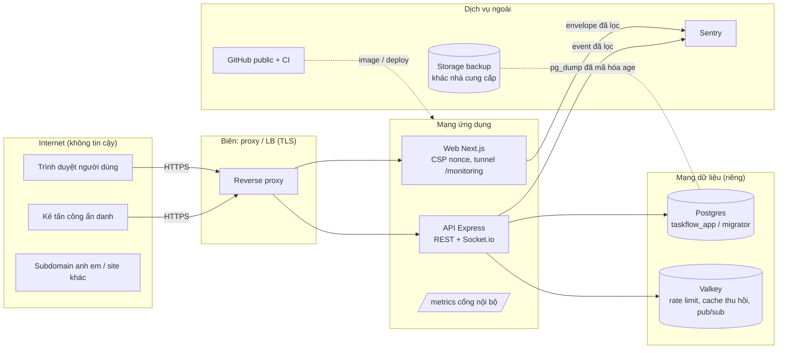

# Threat model v1 (STRIDE) — TaskFlow Enterprise

**Tác giả:** Engineer B · **Ngày:** 2026-10-15 · **Mốc:** main sau T-028, T-032, T-034, T-035, B2
**Quan hệ:** tài liệu này là threat model **đầy đủ** của v1. `security.md` §0 là bản tóm tắt và trỏ về đây. Cơ chế chi tiết nằm ở `security.md` (auth, phân quyền, IDOR, realtime, hardening), `devops.md` (vận hành) và các runbook trong `docs/runbook/`.

**Cách đọc:** mỗi dòng STRIDE nêu (1) mối đe dọa cụ thể, (2) biện pháp và nơi nó nằm, (3) cách biện pháp được **kiểm chứng** tự động (test, cổng hộp đen, CI), (4) phần còn lại. Phần còn lại được chấp nhận có chủ đích nằm ở mục 6, kèm ADR.

---

## 1. Phạm vi và giả định

**Trong phạm vi:** web (`apps/web`, Next.js), API (`apps/api`, Express 5 + Socket.io), Postgres 18, Valkey, storage sao lưu, repo GitHub public + CI, giám sát (Sentry, metrics, log).

**Giả định:**
- **G1.** Production chạy sau ít nhất một reverse proxy / load balancer terminate TLS. `TRUST_PROXY_HOPS` được đo đúng (go-live §3.1).
- **G2.** Web và API ở hai origin riêng (`app.`, `api.`) cùng registrable domain (ADR-029).
- **G3.** Người có quyền vận hành (chủ dự án, Tech Lead) là tin cậy; tài khoản của họ bật 2FA (go-live §7.4).
- **G4.** Nhà cung cấp hosting / DB managed không độc hại. Mất trắng tài khoản hosting là kịch bản có xét (backup ngoài nhà cung cấp — B2).
- **G5.** Mã nguồn công khai (ADR-072): thiết kế không dựa vào việc giấu code.

### 1.1 Sơ đồ và biên tin cậy

**Biên tin cậy:** (TB1) Internet ↔ proxy · (TB2) proxy ↔ web/API · (TB3) API ↔ Postgres / Valkey · (TB4) app ↔ Sentry · (TB5) DB ↔ storage backup · (TB6) repo/CI ↔ runtime.

## 2. Tài sản

| Tài sản | Vì sao quan trọng |
|---|---|
| Dữ liệu task / project / workspace của từng tenant | Bí mật kinh doanh của khách; rò chéo tenant là sự cố nghiêm trọng nhất |
| Phiên (refresh token, access token, `tv`, `sid`) | Chiếm phiên = chiếm tài khoản |
| Mật khẩu (hash argon2id), email | Dữ liệu cá nhân; hash là vật liệu để dò offline |
| Quyền (role trong workspace) | Leo thang ⇒ xóa / đọc dữ liệu không được phép |
| Secret vận hành (JWT, DB, Valkey, `METRICS_TOKEN`, token GitHub / hosting) | Lộ ⇒ giả mạo token, đọc DB |
| Bản sao lưu + khóa giải mã | Bản sao toàn bộ dữ liệu |
| Tính sẵn sàng (API, socket, DB pool) | Nhóm làm việc phụ thuộc board realtime |
| Log / sự kiện bảo mật | Điều tra sự cố; bản thân log không được chứa bí mật |

## 3. Tác nhân đe dọa

| Tác nhân | Năng lực giả định |
|---|---|
| **T1** Kẻ tấn công ẩn danh | Gửi request tùy ý, xoay IP / IPv6, đọc toàn bộ mã nguồn |
| **T2** Người dùng hợp lệ ở workspace khác | Có tài khoản + token hợp lệ, đoán / liệt kê id |
| **T3** Thành viên trong workspace (role thấp) | VIEWER / MEMBER muốn làm việc của PM / OWNER; request đang bay khi bị hạ quyền |
| **T4** Kẻ cầm token bị trộm | Có refresh cookie hoặc access token của nạn nhân (malware, máy dùng chung) |
| **T5** Kẻ kiểm soát subdomain anh em / trang lạ | Đặt cookie `Domain=` cha, tạo request cross-site, nhúng iframe |
| **T6** Kẻ chiếm máy chạy job (backup, CI) | Đọc env của job |
| **T7** Chuỗi cung ứng | Dependency / action / image bị cài mã độc |

## 4. STRIDE theo thành phần

### 4.1 Web (Next.js, trình duyệt)

| Mối đe dọa | Biện pháp | Kiểm chứng | Còn lại |
|---|---|---|---|
| **S** — Open redirect sau login (`?next=`) dẫn tới trang phishing | `safeNextPath` kiểm sau chuẩn hóa URL (dot-segment, `%2e`, `//`, `/\`) | Unit test các biến thể (T-029, H1 của T-028); E2E | — |
| **S** — Login CSRF / cookie tossing từ subdomain anh em | Cookie `__Host-tf_rt` (cấm `Domain=`); server chỉ đọc đúng tên; nhiều cookie trùng ⇒ thu hồi mọi family (ADR-109) | `cookie-tossing.http.test.ts`; cổng hộp đen SEC-34…34e (F) | R7 |
| **T** — XSS chèn script | React chỉ render text; cấm `dangerouslySetInnerHTML` (ESLint); CSP nonce + `strict-dynamic`, không `unsafe-inline/eval` | `csp.test.ts`; review T-028 / T-034 | R19 (XSS ở subdomain khác) |
| **I** — Token lộ qua storage / URL / log | Access token chỉ trong biến module; refresh HttpOnly; không localStorage (ESLint); `credentials: include` chỉ cho `/auth/*` | Review T-028; ESLint rule | Access token nằm trong cache mutation tối đa 5 phút (L11 T-028, không tăng khả năng khai thác) |
| **I** — Server message lộ chi tiết nội bộ trên UI | UI map lỗi theo `code` / `issue.code`, fallback cố định | `form-errors.test.ts` (T-034 F2) | — |
| **I** — Mật khẩu lên URL khi form submit trước hydration | Form POST / disable trước mount (T-029, M6) | Test form | — |
| **D** — Tunnel Sentry `/monitoring` bị lạm dụng | Chỉ DSN đã cấu hình (không SSRF); body đọc luồng ≤ 200 kB; 30 / phút / IP + 300 / phút / instance; chỉ item `event` | `sentry-tunnel.test.ts` (luồng vô hạn ⇒ 413, 25k IP ⇒ Map ≤ 10k) | R15 |
| **E** — UI cho phép thao tác server sẽ từ chối | Ẩn theo role (`can()`); server là cổng thật | Real-API test T-034 (`admin-refusals.real.tsx`) | — |
| **E** — Mock web dễ dãi hơn server (bài học H2) | Mock kiểm Content-Type / Origin / quyền như server; contract test mock ⊆ server | `realtime-event-parity.test.ts`; real-API suites | — |

### 4.2 API — xác thực và phiên

| Mối đe dọa | Biện pháp | Kiểm chứng | Còn lại |
|---|---|---|---|
| **S** — Brute force / credential stuffing | argon2id (ADR-065); limiter login 20 / 15 phút / IP + (IP, email) 10 lần 401 / 15 phút + email 100 / giờ, chỉ đếm 401 (ADR-108); fail-closed khi Valkey chết | SEC-28; `rules` tests | R3, R4 |
| **S** — Dò tài khoản qua login | Cùng lỗi + cùng thời gian (DUMMY_HASH) cho email lạ / sai mật khẩu | SEC-27 (chênh trung vị < 50ms) | R1, R2 (register / add-member) |
| **S** — Giả mạo JWT (`alg:none`, sai secret, thiếu `tv`) | jose whitelist HS256, `kid`, iss / aud / exp, `requiredClaims` | SEC-25; `jose-access-token-service.test.ts` | R8 |
| **S** — Dùng lại refresh token bị trộm | Rotation + phát hiện reuse ⇒ thu hồi cả family + `sid-revoked` | REF-04, SEC-18 | — |
| **T / R** — Lost update vô hiệu thu hồi (login ‖ đổi mật khẩu / logout-all) | Lệnh nguyên tử theo ý định (ADR-104); refresh khóa user `FOR SHARE` (X4) | SEC-21c / 23b / 23c ×20 (HTTP); `auth-refresh-races.int.ts` (đỏ khi gỡ bản sửa) | — |
| **I** — Phiên đã đăng xuất sống lại sau khi Valkey restart | Cache miss ⇒ kiểm DB cả `tv` lẫn `sid`; khôi phục `sid-revoked` trước khi nạp `tv` (X3) | `session-cache-refill.test.ts`; SEC-24e / 24f (F) | R5 |
| **I** — Valkey chết khi ghi thu hồi ⇒ token cũ vẫn qua | Ghi thu hồi **trước commit**, lỗi ⇒ 503 + rollback (ADR-105) | SEC-24b | R6 |
| **R** — Không truy vết được sự cố tài khoản | Sự kiện bảo mật có `reqId` + `ip` (`auth.login_failed`, `refresh.reuse_detected`, `auth.password_change_failed`, `auth.refresh_cookie_ambiguous`…) | `security-event-context.http.test.ts` | R12 |

### 4.3 API — phân quyền và đa tenant

| Mối đe dọa | Biện pháp | Kiểm chứng | Còn lại |
|---|---|---|---|
| **I** — IDOR chéo tenant (id ở URL, cursor, socket) | Route lồng + membership middleware + query luôn có `workspaceId` / `projectId` + 404 đồng nhất (ADR-020); cursor gắn `kind`, id phải uuid | test-spec IDOR; `cursor-forgery.http.test.ts`; review T-028 (không IDOR trên 8 route task) | — |
| **E** — Leo thang role (PM tự lên OWNER, MEMBER xóa task người khác) | Ma trận RBAC + TaskPolicy (ADR-022/041/044/045); PM chỉ cấp MEMBER / VIEWER | Unit + real-API (T-034 F5) | — |
| **E** — Request đang bay của người vừa bị hạ / xóa | Đọc lại role actor sau `lockOwners` (X6) | `members-stale-actor.test.ts` (5/5 đỏ khi gỡ bản sửa) | — |
| **T** — Workspace đã xóa sống lại / project mất archive do ghi đồng thời | Optimistic lock `version` (ADR-110) | Race ×20 + cổng hộp đen X2/X8 (40 vòng ⇒ 0 hồi sinh) | — |
| **T** — Ghi vào workspace đang chờ purge | `assertWorkspaceLive` trong transaction (X7) | `deleted-workspace-guard.test.ts` | R20 |
| **D** — LAST_OWNER bị phá bởi race | `lockOwners FOR UPDATE ORDER BY id` (ADR-046) | ROL-05, REM-07 ×20 | — |

### 4.4 API — HTTP, realtime, hạ tầng

| Mối đe dọa | Biện pháp | Kiểm chứng | Còn lại |
|---|---|---|---|
| **S** — CSRF trên endpoint cookie | SameSite=Strict + `Origin` whitelist + bắt buộc `application/json` (UTF-8, charset trùng ⇒ 415) | Middleware tests; transport.sec | — |
| **S** — Giả IP qua `X-Forwarded-For` để né rate limit | `TRUST_PROXY_HOPS` đo thực tế; IPv6 gom /56 | Go-live §3.1 (thủ công); `rate-limit` tests | Phụ thuộc cấu hình đúng (G1) |
| **S** — CSWSH / socket không xác thực | Origin whitelist + token ở `handshake.auth` (không query) + chỉ websocket | `gateway.test.ts` | — |
| **I** — Event realtime lọt sang workspace khác | Join phòng kiểm membership + project ∈ ws, kiểm lại sau join; emit chỉ `project:{id}` | `realtime.http.test.ts`, `project-realtime.http.test.ts` | — |
| **I** — Bí mật / PII vào log hoặc Sentry | Serializer allow-list (T-031 mục 0: lỗi DB không mang dòng dữ liệu); redact header; Sentry `dataCollection` tắt + `beforeSend` allow-list | Test P2039 thật (`sentry-leak.int.ts`); `refresh-cookie-logging.test.ts` | — |
| **I** — `/metrics`, `/healthz` lộ thông tin | `/metrics` cổng riêng, `127.0.0.1` mặc định, Bearer bắt buộc từ staging; `/healthz` không lộ `gitSha` | `metrics` tests; go-live §6.4 | — |
| **D** — Flood tài nguyên (pool DB, socket renew, readyz) | Rate limit toàn cục + theo route; `auth:renew` 5 / phút / socket; socket join budget; body 100 kB | T-030, T-031 tests | Không có giới hạn số socket đồng thời / user (L6 T-028) |
| **D** — Valkey chập chờn làm sập process (redis-adapter publish) | Bọc publish + thu hồi local-first (T-030) | Integration test proxy TCP riêng | R5 |
| **E** — Cấu hình production sai (secret mẫu, cookie không Secure, CORS http, lưu trữ bộ nhớ) | Env validate theo `APP_ENV`, app từ chối khởi động | `env.test.ts`; startup tests | R9 |

### 4.5 Dữ liệu, sao lưu, repo và chuỗi cung ứng

| Mối đe dọa | Biện pháp | Kiểm chứng | Còn lại |
|---|---|---|---|
| **E / T** — App bị chiếm chạy DDL / xóa schema | Tách role: app = `taskflow_app` (chỉ DML), migrate = `taskflow_migrator` | `verify-grants.sh` (CI); drill bước 8 | — |
| **I** — Lộ bản sao lưu | Mã hóa phía client bằng age; máy backup chỉ có public key; storage khác nhà cung cấp; không bản rõ trên đĩa | Drill: không có `PGDMP` trên storage, sai khóa / sửa 1 byte bị từ chối | — |
| **T / D** — Xóa / mã hóa tống tiền bản sao lưu | Credential PutObject-only; xóa bằng lifecycle; versioning / object lock | Runbook backup §3 (cấu hình thủ công) | Phụ thuộc cấu hình bucket |
| **D** — Backup có nhưng không khôi phục được | Diễn tập tự động hằng tuần: đối chiếu dữ liệu / index / constraint / quyền + `pg_amcheck` | `backup-drill.yml`; kiểm đột biến (đỏ đúng chỗ) | R16 |
| **I** — Secret lọt vào repo public | gitleaks pre-commit + CI toàn lịch sử; push protection | CI job gitleaks | Lộ = xoay ngay (go-live §9) |
| **T** — Dependency / action / image độc | Lockfile frozen; action pin theo SHA; image pin version; `pnpm audit`; Trivy | CI | Rủi ro chuỗi cung ứng nền tảng (không loại bỏ được) |
| **T** — Hợp đồng / mock / server lệch nhau | Contract test event parity; real-API suites | `realtime-event-parity.test.ts` | — |

## 5. Những gì đã thay đổi so với threat model ban đầu (T-002)

Các lớp mới được thêm **sau khi** rà soát tìm ra lỗ hổng thật:
- **Cookie `__Host-`:** thay cho `__Secure-` (ADR-109, cookie tossing — T-028 / F).
- **Thu hồi fail-closed trước commit:** ADR-105.
- **Khôi phục `sid-revoked` khi refill cache:** X3.
- **Chống lost update:**
  - lệnh nguyên tử cho trường bảo mật của User (ADR-104);
  - optimistic lock cho Workspace / Project (ADR-110);
  - `FOR SHARE` trong refresh (X4).
- **Đọc lại role actor trong transaction:** X6.
- **Log và Sentry không mang dữ liệu dòng DB:** T-031 mục 0, H4 của T-028.
- **Redis-adapter không làm sập process:** T-030, H3.
- **Mock web phải khắt khe như server:** H2 → T-029; contract test event parity.
- **Sao lưu mã hóa có diễn tập tự động:** B2.

## 6. Rủi ro chấp nhận có chủ đích

| # | Rủi ro | Vì sao chấp nhận / giới hạn | Quyết định | Xem lại khi |
|---|---|---|---|---|
| R1 | Register với email đã có ⇒ `409` (lộ email đã đăng ký) | Trải nghiệm v1; rate limit 5 / giờ / IP | ADR-049 | Có hạ tầng email (xác minh email, luôn 202) |
| R2 | Thêm thành viên bằng email lạ ⇒ `404 user` (người có `member:add` biết email có tài khoản) | Chỉ PM / OWNER làm được; 30 / giờ / user | ADR-090 | Có lời mời qua email |
| R3 | Kẻ tấn công có ≥ 100 lần 401 / giờ trên nhiều IP vẫn làm chậm đăng nhập của nạn nhân tối đa 1 giờ | Đánh đổi giữa chống stuffing và chống khóa tài khoản | ADR-108 | Có CAPTCHA / backoff (sau v1) |
| R4 | Mật khẩu tối thiểu 12 ký tự (< 15 của NIST cho yếu tố duy nhất), chưa có MFA | Quyết định của người dùng; bù bằng blocklist + argon2id + rate limit | ADR-049, `security.md` §6.5 | Có MFA hoặc yêu cầu tuân thủ |
| R5 | Valkey chết khi chạy nhiều instance ⇒ instance khác không nhận lệnh thu hồi socket; socket còn nhận event ≤ 15 phút (TTL access token). REST vẫn kiểm `tv` / `sid` với fallback DB | Lưới an toàn: recheck ở `auth:renew` + hết hạn token | ADR-105, `security.md` §5.4 | Có Valkey HA / pub-sub bền |
| R6 | Ghi thu hồi trước commit rồi rollback ⇒ token hợp lệ có thể bị 401 tối đa 60s / 905s | Hướng an toàn (fail-closed) | ADR-105 | — |
| R7 | Cookie refresh `Path=/` đi kèm mọi request tới API origin | Bắt buộc bởi `__Host-`; vẫn HttpOnly + SameSite=Strict; header Cookie đã redact | ADR-109 | — |
| R8 | JWT HS256 đối xứng: lộ `JWT_ACCESS_SECRET` = giả mạo được access token | Một service vừa ký vừa xác minh; xoay khóa có runbook (không giữ khóa lộ làm `_PREVIOUS`) | **ADR-113**; `security.md` §2.1, go-live §9 | ≥ 2 dịch vụ kiểm token ⇒ chuyển EdDSA / ES256 (ADR-113) |
| R9 | Thiếu `SENTRY_DSN` ở staging / production ⇒ app vẫn chạy, chỉ cảnh báo | Giám sát không được làm sập app | **ADR-113** (T-035) | Go-live **bắt buộc** đặt DSN (ADR-113; go-live §6.3) |
| R10 | Chưa có quên mật khẩu / xác minh email / quản lý phiên trên UI | Cần hạ tầng email; schema đã sẵn | `security.md` §1.9 | Lộ trình sau v1 |
| R12 | Log gói miễn phí có thể giữ < 90 ngày | Chi phí; phương án xuất log bảo mật | ADR-073, `devops.md` §6 | Có ngân sách giám sát |
| R13 | Cảnh báo chỉ qua email (không đánh thức ai) | Gói miễn phí | ADR-073 | Có on-call |
| R15 | Bất kỳ ai có thể gửi event lỗi qua tunnel (trong hạn mức rate limit) — tốn quota Sentry | DSN trình duyệt công khai theo thiết kế của Sentry; chỉ item `event` | **ADR-113** (T-035) | Quota Sentry bị đốt thực tế (ADR-113) |
| R16 | Mất cả tài khoản hosting ⇒ RPO ≤ 24h (bản logic hằng ngày) | PITR của nền tảng phủ RPO ≤ 5 phút trong trường hợp thường | `devops.md` §4.3, B2 | Yêu cầu RPO chặt hơn |
| R17 | Event realtime đang phát dở lúc shutdown bị mất | Client reconnect + refetch | ADR-012 | — |
| R19 | XSS trên một subdomain anh em vẫn nguy hiểm cho người dùng (dù không còn tossing được cookie) | Phụ thuộc vệ sinh DNS (go-live §2.5) | ADR-029, ADR-109 | Có subdomain do bên thứ ba vận hành |
| R20 | Workspace xóa mềm giữ dữ liệu 30 ngày trước khi purge | Chủ đích để khôi phục | ADR-047 | Yêu cầu xóa ngay (GDPR-like) |

R11 (Valkey không persistence) đã khắc phục bằng X3 nên không còn trong danh sách; phần còn lại thuộc R5. R14 (image GHCR public) không phải rủi ro vì image không chứa secret (Trivy secret scan).

## 7. Ngoài phạm vi v1

- Tấn công từ nhà cung cấp hosting / DB managed (G4).
- DDoS tầng mạng (L3 / L4): thuộc nhà cung cấp / CDN.
- Thiết bị người dùng đã bị chiếm hoàn toàn (keylogger): chỉ MFA mới giảm được (R4).
- Tuân thủ pháp lý cụ thể (GDPR, PDPD): cần phân tích riêng khi có khách hàng thật.

## 8. Duy trì tài liệu

Cập nhật threat model khi:
- thêm thành phần / dịch vụ ngoài mới;
- thêm biên tin cậy (service thứ hai, worker, webhook);
- có quyết định chấp nhận rủi ro mới (thêm dòng mục 6 + ADR);
- một rủi ro được xử lý (chuyển vào mục 5);
- một finding High / Critical từ review hay sự cố.

Người review bảo mật trước merge (B) kiểm mục 4 cho mọi PR đụng xác thực, phân quyền, realtime, cấu hình production.
