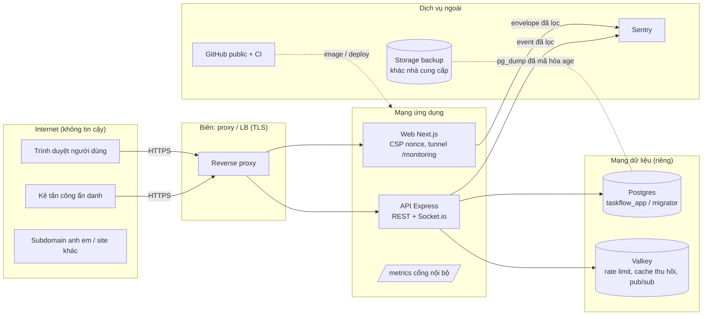

# Threat model v1 (STRIDE) — TaskFlow Enterprise

**Tác giả:** Engineer B · **Ngày:** 2026-10-15 · **Mốc:** main sau T-028, T-032, T-034, T-035, B2
**Quan hệ:** tài liệu này là threat model **đầy đủ** của v1. `security.md` §0 là bản tóm tắt và trỏ về đây. Cơ chế chi tiết nằm ở `security.md` (auth, phân quyền, IDOR, realtime, hardening), `devops.md` (vận hành) và các runbook trong `docs/runbook/`.

**Cách đọc:** mỗi dòng STRIDE nêu (1) mối đe dọa cụ thể, (2) biện pháp và nơi nó nằm, (3) cách biện pháp được **kiểm chứng** tự động (test, cổng hộp đen, CI), (4) phần còn lại. Phần còn lại được chấp nhận có chủ đích nằm ở mục 6, kèm ADR.

---

## 1. Phạm vi và giả định

**Trong phạm vi:** web (`apps/web`, Next.js), API (`apps/api`, Express 5 + Socket.io), Postgres 18, Valkey, storage sao lưu, repo GitHub public + CI, giám sát (Sentry, metrics, log).

**Giả định:**
- **G1.** Production chạy sau ít nhất một reverse proxy / load balancer terminate TLS. `TRUST_PROXY_HOPS` được đo đúng (go-live §3.1).
- **G2.** Web và API ở hai origin riêng (`app.`, `api.`) cùng registrable domain (ADR-029).
- **G3.** Người có quyền vận hành (chủ dự án, Tech Lead) là tin cậy; tài khoản của họ bật 2FA (go-live §7.4).
- **G4.** Nhà cung cấp hosting / DB managed không độc hại. Mất trắng tài khoản hosting là kịch bản có xét (backup ngoài nhà cung cấp — B2).
- **G5.** Mã nguồn công khai (ADR-072): thiết kế không dựa vào việc giấu code.

### 1.1 Sơ đồ và biên tin cậy

**Biên tin cậy:** (TB1) Internet ↔ proxy · (TB2) proxy ↔ web/API · (TB3) API ↔ Postgres / Valkey · (TB4) app ↔ Sentry · (TB5) DB ↔ storage backup · (TB6) repo/CI ↔ runtime.

## 2. Tài sản

| Tài sản | Vì sao quan trọng |
|---|---|
| Dữ liệu task / project / workspace của từng tenant | Bí mật kinh doanh của khách; rò chéo tenant là sự cố nghiêm trọng nhất |
| Phiên (refresh token, access token, `tv`, `sid`) | Chiếm phiên = chiếm tài khoản |
| Mật khẩu (hash argon2id), email | Dữ liệu cá nhân; hash là vật liệu để dò offline |
| Quyền (role trong workspace) | Leo thang ⇒ xóa / đọc dữ liệu không được phép |
| Secret vận hành (JWT, DB, Valkey, `METRICS_TOKEN`, token GitHub / hosting) | Lộ ⇒ giả mạo token, đọc DB |
| Bản sao lưu + khóa giải mã | Bản sao toàn bộ dữ liệu |
| Tính sẵn sàng (API, socket, DB pool) | Nhóm làm việc phụ thuộc board realtime |
| Log / sự kiện bảo mật | Điều tra sự cố; bản thân log không được chứa bí mật |

## 3. Tác nhân đe dọa

| Tác nhân | Năng lực giả định |
|---|---|
| **T1** Kẻ tấn công ẩn danh | Gửi request tùy ý, xoay IP / IPv6, đọc toàn bộ mã nguồn |
| **T2** Người dùng hợp lệ ở workspace khác | Có tài khoản + token hợp lệ, đoán / liệt kê id |
| **T3** Thành viên trong workspace (role thấp) | VIEWER / MEMBER muốn làm việc của PM / OWNER; request đang bay khi bị hạ quyền |
| **T4** Kẻ cầm token bị trộm | Có refresh cookie hoặc access token của nạn nhân (malware, máy dùng chung) |
| **T5** Kẻ kiểm soát subdomain anh em / trang lạ | Đặt cookie `Domain=` cha, tạo request cross-site, nhúng iframe |
| **T6** Kẻ chiếm máy chạy job (backup, CI) | Đọc env của job |
| **T7** Chuỗi cung ứng | Dependency / action / image bị cài mã độc |

## 4. STRIDE theo thành phần

### 4.1 Web (Next.js, trình duyệt)

| Mối đe dọa | Biện pháp | Kiểm chứng | Còn lại |
|---|---|---|---|
| **S** — Open redirect sau login (`?next=`) dẫn tới trang phishing | `safeNextPath` kiểm sau chuẩn hóa URL (dot-segment, `%2e`, `//`, `/\`) | Unit test các biến thể (T-029, H1 của T-028); E2E | — |
| **S** — Login CSRF / cookie tossing từ subdomain anh em | Cookie `__Host-tf_rt` (cấm `Domain=`); server chỉ đọc đúng tên; nhiều cookie trùng ⇒ thu hồi mọi family (ADR-109) | `cookie-tossing.http.test.ts`; cổng hộp đen SEC-34…34e (F) | R7 |
| **T** — XSS chèn script | React chỉ render text; cấm `dangerouslySetInnerHTML` (ESLint); CSP nonce + `strict-dynamic`, không `unsafe-inline/eval` | `csp.test.ts`; review T-028 / T-034 | R19 (XSS ở subdomain khác) |
| **I** — Token lộ qua storage / URL / log | Access token chỉ trong biến module; refresh HttpOnly; không localStorage (ESLint); `credentials: include` chỉ cho `/auth/*` | Review T-028; ESLint rule | Access token nằm trong cache mutation tối đa 5 phút (L11 T-028, không tăng khả năng khai thác) |
| **I** — Server message lộ chi tiết nội bộ trên UI | UI map lỗi theo `code` / `issue.code`, fallback cố định | `form-errors.test.ts` (T-034 F2) | — |
| **I** — Mật khẩu lên URL khi form submit trước hydration | Form POST / disable trước mount (T-029, M6) | Test form | — |
| **D** — Tunnel Sentry `/monitoring` bị lạm dụng | Chỉ DSN đã cấu hình (không SSRF); body đọc luồng ≤ 200 kB; 30 / phút / IP + 300 / phút / instance; chỉ item `event` | `sentry-tunnel.test.ts` (luồng vô hạn ⇒ 413, 25k IP ⇒ Map ≤ 10k) | R15 (trần toàn cục = 300 × N instance web — R24) |
| **E** — UI cho phép thao tác server sẽ từ chối | Ẩn theo role (`can()`); server là cổng thật | Real-API test T-034 (`admin-refusals.real.tsx`) | — |
| **E** — Mock web dễ dãi hơn server (bài học H2) | Mock kiểm Content-Type / Origin / quyền như server; contract test mock ⊆ server | `realtime-event-parity.test.ts`; real-API suites | — |

### 4.2 API — xác thực và phiên

| Mối đe dọa | Biện pháp | Kiểm chứng | Còn lại |
|---|---|---|---|
| **S** — Brute force / credential stuffing | argon2id (ADR-065); limiter login 20 / 15 phút / IP + (IP, email) 10 lần 401 / 15 phút + email 100 / giờ, chỉ đếm 401 (ADR-108); fail-closed khi Valkey chết | SEC-28; `rules` tests | R3, R4 |
| **S** — Dò tài khoản qua login | Cùng lỗi + cùng thời gian (DUMMY_HASH) cho email lạ / sai mật khẩu | SEC-27 (chênh trung vị < 50ms) | R1, R2 (register / add-member) |
| **S** — Giả mạo JWT (`alg:none`, sai secret, thiếu `tv`) | jose whitelist HS256, `kid`, iss / aud / exp, `requiredClaims` | SEC-25; `jose-access-token-service.test.ts` | R8 |
| **S** — Dùng lại refresh token bị trộm | Rotation + phát hiện reuse ⇒ thu hồi cả family + `sid-revoked` | REF-04, SEC-18 | — |
| **T / R** — Lost update vô hiệu thu hồi (login ‖ đổi mật khẩu / logout-all) | Lệnh nguyên tử theo ý định (ADR-104); refresh khóa user `FOR SHARE` (X4) | SEC-21c / 23b / 23c ×20 (HTTP); `auth-refresh-races.int.ts` (đỏ khi gỡ bản sửa) | — |
| **S** — Mật khẩu cũ nhận phiên sống sót qua lần đổi mật khẩu (login verify argon2 xen với change-password) | `recordLogin` có điều kiện `password_hash = hash vừa verify` (mở rộng ADR-104); lệch ⇒ 401, không cấp phiên | SEC-23e (tất định, đỏ trên code cũ); SEC-23b ×20 không còn chấp nhận phiên sống sót; contract + unit | G1 auth M1 (D) — sửa trên `fix/auth-login-pwchange-race` |
| **I** — Phiên đã đăng xuất sống lại sau khi Valkey restart | Cache miss ⇒ kiểm DB cả `tv` lẫn `sid`; khôi phục `sid-revoked` trước khi nạp `tv` (X3) | `session-cache-refill.test.ts`; SEC-24e / 24f (F) | R5 |
| **I** — Valkey chết khi ghi thu hồi ⇒ token cũ vẫn qua | Ghi thu hồi **trước commit**, lỗi ⇒ 503 + rollback (ADR-105) | SEC-24b | R6 |
| **R** — Không truy vết được sự cố tài khoản | Sự kiện bảo mật có `reqId` + `ip` (`auth.login_failed`, `refresh.reuse_detected`, `auth.password_change_failed`, `auth.refresh_cookie_ambiguous`…) | `security-event-context.http.test.ts` | R12 |

### 4.3 API — phân quyền và đa tenant

| Mối đe dọa | Biện pháp | Kiểm chứng | Còn lại |
|---|---|---|---|
| **I** — IDOR chéo tenant (id ở URL, cursor, socket) | Route lồng + membership middleware + query luôn có `workspaceId` / `projectId` + 404 đồng nhất (ADR-020); cursor gắn `kind`, id phải uuid | test-spec IDOR; `cursor-forgery.http.test.ts`; review T-028 (không IDOR trên 8 route task) | — |
| **E** — Leo thang role (PM tự lên OWNER, MEMBER xóa task người khác) | Ma trận RBAC + TaskPolicy (ADR-022/041/044/045); PM chỉ cấp MEMBER / VIEWER | Unit + real-API (T-034 F5) | — |
| **E** — Request đang bay của người vừa bị hạ / xóa | Đọc lại role actor sau `lockOwners` (X6) | `members-stale-actor.test.ts` (5/5 đỏ khi gỡ bản sửa) | — |
| **T** — Workspace đã xóa sống lại / project mất archive do ghi đồng thời | Optimistic lock `version` (ADR-110) | Race ×20 + cổng hộp đen X2/X8 (40 vòng ⇒ 0 hồi sinh) | — |
| **T** — Ghi vào workspace đang chờ purge | `assertWorkspaceLive` trong transaction (X7) | `deleted-workspace-guard.test.ts` | R20 |
| **D** — LAST_OWNER bị phá bởi race | `lockOwners FOR UPDATE ORDER BY id` (ADR-046) | ROL-05, REM-07 ×20 | — |
| **E** — Quyền cấp công ty (Mốc 3.5): HR / Admin bị thu quyền hoặc nghỉ việc vẫn ghi được nhờ token cũ; deadlock / ghi đôi khi hoàn tất nghỉ việc chạy song song | Mọi lệnh ghi `hr:manage` / `payroll:manage` / `company:*` khóa dòng `company_members` của actor FOR SHARE rồi đọc lại role + grants (B-H3); không thuộc công ty / quá `access_until` ⇒ 401 `SESSION_REVOKED`; luật self tuyệt đối; thứ tự khóa toàn cục ADR-136: `taskflow:company:admins` (bậc 2) → `taskflow:leave:<user>` / `taskflow:attendance:punch:<user>` (bậc 3–4) → dòng `company_members` (bậc 5); hoàn tất `DELETE … RETURNING` đếm 1 ⇒ đúng một departure | `company-access.test.ts`; `company/testing/offboarding.test.ts`; `test/integration/company/offboarding.int.ts` (thứ tự khóa, 2 lượt đua ⇒ 1 departure, 2 kết nối submit ‖ hoàn tất và lên lịch nghỉ Admin ‖ hạ Admin — HIGH-1 của A cho T-062); tầng I leave / attendance (khóa ×20); `hr-audit.http.test.ts`, `company.http.test.ts` | R37, R40 |

### 4.4 API — HTTP, realtime, hạ tầng

| Mối đe dọa | Biện pháp | Kiểm chứng | Còn lại |
|---|---|---|---|
| **S** — CSRF trên endpoint cookie | SameSite=Strict + `Origin` whitelist + bắt buộc `application/json` (UTF-8, charset trùng ⇒ 415) | Middleware tests; transport.sec | — |
| **S** — Giả IP qua `X-Forwarded-For` để né rate limit | `TRUST_PROXY_HOPS` đo thực tế; IPv6 gom /56 | Go-live §3.1 (thủ công); `rate-limit` tests | Phụ thuộc cấu hình đúng (G1) |
| **S** — CSWSH / socket không xác thực | Origin whitelist + token ở `handshake.auth` (không query) + chỉ websocket | `gateway.test.ts` | — |
| **I** — Event realtime lọt sang workspace khác | Join phòng kiểm membership + project ∈ ws, kiểm lại sau join; emit chỉ `project:{id}`; thu hồi rời phòng theo cả `projectIds` lẫn `socket.data.joined` lọc theo workspace (bắt project tạo / join song song) | `realtime.http.test.ts`, `project-realtime.http.test.ts`, `gateway.test.ts` (G1 realtime) | — |
| **E** — Socket sống sót sau thu hồi phiên commit giữa handshake | Vào phòng `user` / `session` rồi verify token lần nữa; lỗi ⇒ ngắt (fail-closed); `project:join` chờ kết quả. Thu hồi đăng ký trước các hook phụ sau commit | `gateway.test.ts` (M1), `remove-member-revoke-order.test.ts` | — |
| **I** — Bí mật / PII vào log hoặc Sentry | Serializer allow-list (T-031 mục 0: lỗi DB không mang dòng dữ liệu); redact header; Sentry `dataCollection` tắt + `beforeSend` allow-list | Test P2039 thật (`sentry-leak.int.ts`); `refresh-cookie-logging.test.ts` | — |
| **I** — `/metrics`, `/healthz` lộ thông tin | `/metrics` cổng riêng, `127.0.0.1` mặc định, Bearer bắt buộc từ staging; `/healthz` không lộ `gitSha` | `metrics` tests; go-live §6.4 | — |
| **D** — Flood tài nguyên (pool DB, socket renew, readyz) | Rate limit toàn cục + theo route (luật IP đo cho một văn phòng ~200 người chung IP NAT — T-076: handshake 600 / phút, login 300 / 15 phút, refresh 1200 / 5 phút; login sai 30 / 15 phút / IP; lớp chính theo user / socket / (IP, email)); `auth:renew` 5 / phút / socket; join 30 / phút / socket + 60 / phút / user; tối đa 20 socket / user / instance; body 100 kB | T-030, T-031, `gateway.test.ts` (G1 realtime M2); `shared-quota.integration.test.ts` (2 gateway thật cùng Valkey: socket 21 bị từ chối dù nối sang instance kia) | > 1 instance: hạn mức user đếm chung qua Valkey (`rt-shared-limits`); Valkey lỗi ⇒ nhân N (R21). `/readyz` vẫn nhân N (R24) |
| **D** — Valkey chập chờn làm sập process (redis-adapter publish) | Bọc publish + thu hồi local-first (T-030) | Integration test proxy TCP riêng | R5 |
| **E** — Cấu hình production sai (secret mẫu, cookie không Secure, CORS http, lưu trữ bộ nhớ) | Env validate theo `APP_ENV`, app từ chối khởi động | `env.test.ts`; startup tests | R9 |

### 4.5 Dữ liệu, sao lưu, repo và chuỗi cung ứng

| Mối đe dọa | Biện pháp | Kiểm chứng | Còn lại |
|---|---|---|---|
| **E / T** — App bị chiếm chạy DDL / xóa schema | Tách role: app = `taskflow_app` (chỉ DML), migrate = `taskflow_migrator` | `verify-grants.sh` (CI); drill bước 8 | — |
| **I** — Lộ bản sao lưu | Mã hóa phía client bằng age; máy backup chỉ có public key; storage khác nhà cung cấp; không bản rõ trên đĩa | Drill: không có `PGDMP` trên storage, sai khóa / sửa 1 byte bị từ chối | — |
| **T / D** — Xóa / ghi đè / mã hóa tống tiền bản sao lưu | Credential PutObject-only; xóa bằng lifecycle; **versioning + object lock bắt buộc** (PutObject ghi đè được khóa đoán được) | Runbook backup §3 (cấu hình thủ công) | **Đã sửa trên `main`** (`fc75215`). Còn phụ thuộc cấu hình bucket lúc tạo (go-live) |
| **S / T** — Máy backup bị chiếm dựng bản "mới nhất" hợp lệ (age chỉ bảo đảm toàn vẹn, không bảo đảm nguồn gốc) | Sự cố bảo mật ⇒ khôi phục bản trước thời điểm bị chiếm; kiểm TOC so với DB dựng sạch; không khôi phục bằng superuser | Runbook backup §5.1 | **Đã sửa trên `main`** (`fc75215`); R22 |
| **I** — Mật khẩu DB lộ qua argv của `pg_dump` | `backup.sh` từ chối URL có mật khẩu; dùng `PGPASSWORD` / `PGPASSFILE` | Drill kiểm từ chối (exit 2) — diễn tập xanh 2026-10-16 | **Đã sửa trên `main`** (`fc75215`) |
| **D** — Backup có nhưng không khôi phục được | Diễn tập tự động hằng tuần: đối chiếu dữ liệu / index / constraint / quyền + `pg_amcheck` | `backup-drill.yml`; kiểm đột biến (đỏ đúng chỗ) | R16 |
| **I** — Secret lọt vào repo public | gitleaks pre-commit + CI toàn lịch sử; push protection | CI job gitleaks | Lộ = xoay ngay (go-live §9) |
| **T** — Dependency / action / image độc | Lockfile frozen; action pin theo SHA; image pin version; `pnpm audit`; Trivy | CI | Rủi ro chuỗi cung ứng nền tảng (không loại bỏ được) |
| **T / E** — Image do người ngoài build lên registry chính thức (`workflow_run` của PR fork có nhánh tên `main`) | Release chỉ chạy cho `push` từ chính repo trên `main`; deploy theo digest + required reviewers | Review G1-D3 H1; go-live §7.7: PR thử từ fork ⇒ Release bị bỏ qua | **Đã sửa trên `main`** (D3, `0339da1`) |
| **E** — Khóa SSH deploy (VPS) lộ = root qua nhóm `docker` | `authorized_keys` `restrict,command=` (`ci-entry.sh`, root sở hữu): chỉ `deploy <sha40> <digest…> <sha256 compose> <sha256 Caddyfile>` / `rollback`, **không ghi file nào**; cấu hình do admin cài tay, lệch hash ⇒ từ chối. Khóa lộ chỉ deploy được image đã có trên GHCR với cấu hình đã cài | Review G1-D3 M1 vòng 2 (B chạy thử ci-entry: khớp 0 / lệch 3 / sai dạng 2) | **Đã sửa trên `main`** (D3, `0339da1`) |
| **E** — Deploy production từ nhánh khác / SHA chưa qua staging | Job `guard` (trước bước duyệt): chỉ `main`; production cần deployment `task=deploy:smoke-ok` với `ref = git_sha` do job staging tạo SAU smoke. Environment: Deployment branches = `main` cho cả 2, required reviewers cho production, secret chỉ ở environment | Review G1-D3 M2; go-live §7.8 (ảnh cấu hình + dispatch thử từ nhánh khác bị từ chối); lần deploy staging đầu: kiểm bản ghi `deploy:smoke-ok` | **Đã sửa trên `main`** (D3, `0339da1`). Guard trong file vượt được từ nhánh khác ⇒ ranh giới thật là cấu hình environment |
| **T** — Hợp đồng / mock / server lệch nhau | Contract test event parity; real-API suites | `realtime-event-parity.test.ts` | — |

## 5. Những gì đã thay đổi so với threat model ban đầu (T-002)

Các lớp mới được thêm **sau khi** rà soát tìm ra lỗ hổng thật:
- **Cookie `__Host-`:** thay cho `__Secure-` (ADR-109, cookie tossing — T-028 / F).
- **Thu hồi fail-closed trước commit:** ADR-105.
- **Khôi phục `sid-revoked` khi refill cache:** X3.
- **Chống lost update:**
  - lệnh nguyên tử cho trường bảo mật của User (ADR-104);
  - optimistic lock cho Workspace / Project (ADR-110);
  - `FOR SHARE` trong refresh (X4).
- **Đọc lại role actor trong transaction:** X6.
- **Log và Sentry không mang dữ liệu dòng DB:** T-031 mục 0, H4 của T-028.
- **Redis-adapter không làm sập process:** T-030, H3.
- **Mock web phải khắt khe như server:** H2 → T-029; contract test event parity.
- **Sao lưu mã hóa có diễn tập tự động:** B2. Sửa sau G1 B2 (object lock bắt buộc, khôi phục bản trước thời điểm bị chiếm, không mật khẩu trong argv) đã vào `main` (`fc75215`) sau diễn tập xanh.
- **Deploy (D3) sau G1-D3:** release chỉ từ push `main` của chính repo (H1); khóa CI là forced command không ghi file (M1); production chỉ nhận SHA đã smoke xanh trên staging (M2).
- **Realtime sau G1:** xác thực lại sau handshake, trần socket / join theo user, renew kiểm lại lỗi ⇒ ngắt, thu hồi theo `joined`, thu hồi đăng ký trước hook phụ; client nối lại có jitter.
- **Bảo trì sau G1 T-033:** rank `~` kẹt (High) đã sửa; purge một workspace lỗi không dừng cả lô; shutdown dừng purge giữa các workspace (F7).
- **Một công ty (Mốc 3.5, ADR-133…140):** tắt tự đăng ký (R1 đóng), quyền nhân sự / lương ở cấp công ty đọc lại dưới khóa (B-H3), luật self tuyệt đối (R26 đóng), `access_until` áp ở mọi cửa (HTTP, refresh, socket), thứ tự khóa toàn cục (ADR-136 — review D phát hiện deadlock hoàn tất nghỉ việc ↔ gửi đơn trước khi code); rủi ro mới R37–R42.

## 6. Rủi ro chấp nhận có chủ đích

| # | Rủi ro | Vì sao chấp nhận / giới hạn | Quyết định | Xem lại khi |
|---|---|---|---|---|
| R1 | ~~Register với email đã có ⇒ `409`~~ — **đóng (Mốc 3.5)**: không còn `/auth/register`; chỉ HR / Admin tạo tài khoản bằng link kích hoạt | — | ADR-049 → **ADR-137** | — |
| R2 | Thêm thành viên ws theo `userId` (Mốc 3.5): id lạ ⇒ `404 user`, người đã rời / có lịch nghỉ ⇒ `422 NOT_ACTIVE_MEMBER` — phân biệt được "không có" và "đã rời" | Chỉ PM / OWNER; 30 / giờ / user; người có `member:add` vốn đã thấy danh bạ nội bộ (R41) | ADR-090 → **ADR-134** | Có lời mời qua email |
| R3 | Kẻ tấn công có ≥ 100 lần 401 / giờ trên nhiều IP vẫn làm chậm đăng nhập của nạn nhân tối đa 1 giờ | Đánh đổi giữa chống stuffing và chống khóa tài khoản | ADR-108 | Có CAPTCHA / backoff (sau v1) |
| R4 | Mật khẩu tối thiểu 12 ký tự (< 15 của NIST cho yếu tố duy nhất), chưa có MFA | Quyết định của người dùng; bù bằng blocklist + argon2id + rate limit | ADR-049, `security.md` §6.5 | Có MFA hoặc yêu cầu tuân thủ |
| R5 | Valkey chết khi chạy nhiều instance ⇒ instance khác không nhận lệnh thu hồi socket; socket còn nhận event ≤ 15 phút (TTL access token). REST vẫn kiểm `tv` / `sid` với fallback DB | Lưới an toàn: recheck ở `auth:renew` + hết hạn token | ADR-105, `security.md` §5.4 | Có Valkey HA / pub-sub bền |
| R6 | Ghi thu hồi trước commit rồi rollback ⇒ token hợp lệ có thể bị 401 tối đa 60s / 905s | Hướng an toàn (fail-closed) | ADR-105 | — |
| R7 | Cookie refresh `Path=/` đi kèm mọi request tới API origin | Bắt buộc bởi `__Host-`; vẫn HttpOnly + SameSite=Strict; header Cookie đã redact | ADR-109 | — |
| R8 | JWT HS256 đối xứng: lộ `JWT_ACCESS_SECRET` = giả mạo được access token | Một service vừa ký vừa xác minh; xoay khóa có runbook (không giữ khóa lộ làm `_PREVIOUS`) | **ADR-113**; `security.md` §2.1, go-live §9 | ≥ 2 dịch vụ kiểm token ⇒ chuyển EdDSA / ES256 (ADR-113) |
| R9 | Thiếu `SENTRY_DSN` ở staging / production ⇒ app vẫn chạy, chỉ cảnh báo | Giám sát không được làm sập app | **ADR-113** (T-035) | Go-live **bắt buộc** đặt DSN (ADR-113; go-live §6.3) |
| R10 | Chưa có quên mật khẩu / xác minh email / quản lý phiên trên UI | Cần hạ tầng email; schema đã sẵn | `security.md` §1.9 | Lộ trình sau v1 |
| R12 | Log gói miễn phí có thể giữ < 90 ngày | Chi phí; phương án xuất log bảo mật | ADR-073, `devops.md` §6 | Có ngân sách giám sát |
| R13 | Cảnh báo chỉ qua email (không đánh thức ai) | Gói miễn phí | ADR-073 | Có on-call |
| R15 | Bất kỳ ai có thể gửi event lỗi qua tunnel (trong hạn mức rate limit) — tốn quota Sentry | DSN trình duyệt công khai theo thiết kế của Sentry; chỉ item `event` | **ADR-113** (T-035) | Quota Sentry bị đốt thực tế (ADR-113) |
| R16 | Mất cả tài khoản hosting ⇒ RPO ≤ 24h (bản logic hằng ngày) | PITR của nền tảng phủ RPO ≤ 5 phút trong trường hợp thường | `devops.md` §4.3, B2 | Yêu cầu RPO chặt hơn |
| R17 | Event realtime đang phát dở lúc shutdown bị mất | Client reconnect + refetch | ADR-012 | — |
| R19 | XSS trên một subdomain anh em vẫn nguy hiểm cho người dùng (dù không còn tossing được cookie) | Phụ thuộc vệ sinh DNS (go-live §2.5) | ADR-029, ADR-109 | Có subdomain do bên thứ ba vận hành |
| R20 | Workspace xóa mềm giữ dữ liệu 30 ngày trước khi purge | Chủ đích để khôi phục | ADR-047 | Yêu cầu xóa ngay (GDPR-like) |
| R21 | Hạn mức realtime theo user khi **Valkey lỗi** rơi về hạn mức cục bộ của từng instance (fail-open) ⇒ trần thực tế 20 socket × N, 60 join / phút × N, 30 renew / phút × N. Valkey sống: đếm chung (Lua nguyên tử, `TIME` của Valkey), lệch nhỏ: (a) instance chết đột ngột còn được tính ≤ 30 s ⇒ đếm **thừa** (user có thể bị từ chối sớm — phía an toàn); (b) client tự ngắt giữa lúc được cấp suất và sự kiện `connection` (chưa đăng ký release) ⇒ thừa tới heartbeat kế (≤ 10 s); sau khi cấp suất không còn bước nào từ chối handshake; (c) heartbeat ghi đè trong lúc handshake đang chạy ⇒ thiếu ≤ số handshake dở dang tới heartbeat kế, vẫn bị hạn mức cục bộ chặn. Bộ đếm chỉ ghi theo `userId` của phiên đã xác thực ⇒ không ai thả / tăng bộ đếm của người khác | Hạn mức chống lạm dụng, không phải kiểm quyền; fail-closed làm mất realtime mỗi lần Valkey chập chờn | **ADR-115** (`rt-shared-limits`) | Valkey HA; hoặc Cluster ⇒ thiết kế lại khóa (script hiện đọc 2 slot — go-live §4.5 yêu cầu single-node) |
| R22 | Ai có public key age (gồm máy backup) đều tạo được bản backup hợp lệ ⇒ không chứng minh được nguồn gốc | Ký bằng khóa trên máy riêng tăng độ phức tạp vận hành v1 | Runbook backup §1, §5.1 | Có máy ký riêng hoặc storage kéo (pull) từ phía nhà cung cấp |
| R23 | `PATCH` workspace / project không nhận `version` từ client ⇒ 2 OWNER (hoặc 2 PM) sửa tên / slug / mô tả cùng lúc: last-write-wins âm thầm | Người ghi đều có quyền (không leo quyền); slug vẫn được unique constraint chặn trùng; optimistic lock trong transaction (ADR-110) vẫn chặn ghi snapshot cũ đè trạng thái quan trọng (vd hồi sinh workspace đã xóa); event realtime đẩy giá trị cuối cho mọi client (web so `updatedAt`, bằng nhau ⇒ nhận bản sau) | **ADR-117** (G1 workspace-fe I3 / W4 của E) | Có trường nhiều người sửa thường xuyên, hoặc người dùng báo mất chỉnh sửa ⇒ thêm `version` vào body + DTO |
| R24 | Hạn mức đếm trong bộ nhớ từng instance nhân theo N: `/readyz` (60 / phút / IP theo instance), tunnel `/monitoring` 300 / phút / instance (trần toàn cục 300 × N — cùng R15). `project:join` 30 / phút / socket và `auth:renew` 5 / phút / socket gắn kết nối nên không nhân theo instance (nhân theo số socket ≤ 20 / user) | `/readyz`: kết quả probe cache 1 s (`READINESS_CACHE_MS`) ⇒ tải DB ≤ 1 probe / s / instance bất kể số request; hạn mức 60 / phút / IP trong bộ nhớ **có chủ đích** (readiness không được phụ thuộc Valkey); edge là lớp chặn chính. Tunnel chỉ tốn quota Sentry (R15). v1 chạy 1 instance | **ADR-115** (`rt-shared-limits`, ngoài phạm vi có chủ đích) | > 1 instance mà quota Sentry bị đốt hoặc `/readyz` thành điểm khuếch đại tải DB ⇒ chuyển sang bộ đếm Valkey |
| R25 | Chấm công web không chống gian lận vị trí: chỉ ghi IP / UA để đối chiếu; VPN, proxy, nhờ người chấm hộ đều lọt | Người dùng chốt "không giới hạn" (Mốc 3) | **ADR-121** · `attendance-leave.md` §0 | Có máy chấm công (sinh trắc học tại máy) hoặc người dùng yêu cầu giới hạn mạng |
| R26 | ~~OWNER tự duyệt đơn / tự điều chỉnh công, phép của chính mình~~ — **đóng (Mốc 3.5)**: luật self tuyệt đối (ai cũng 403 khi tác động dữ liệu của chính mình; Admin không phải nhân viên, không có dữ liệu chấm công / phép) | — | ADR-122 → **ADR-134/135** | — |
| R27 | IP / UA, lý do nghỉ (có thể là dữ liệu sức khỏe) là dữ liệu cá nhân / nhạy cảm (NĐ 13/2023) — chủ thể là **nhân viên công ty** (Mốc 3.5; mốc tính hạn = `company_member_departures.last_day`; thêm token kích hoạt và tài khoản chờ kích hoạt) | Cần cho đối chiếu chấm công và duyệt nghỉ; chỉ người gửi + HR đọc; không vào CSV / thông báo / log / audit | `attendance-leave.md` §9, `company-level.md` §6 | **Bắt buộc TRƯỚC deploy:** chốt thời hạn lưu, job xóa / ẩn danh, thông báo xử lý dữ liệu cho nhân viên — đề xuất: `data-retention.md` |
| R28 | File CSV bảng công đã tải ra khỏi hệ thống ngoài tầm kiểm soát | Nhu cầu tính lương; không chứa IP / UA / lý do; chỉ có audit EXPORT | **ADR-121** | Có tích hợp tính lương trực tiếp |
| R29 | Thông báo realtime best-effort: rớt socket ⇒ chỉ thấy khi tải lại | Bảng `Notification` bền, client tải lại khi kết nối lại | **ADR-123** | Cần đảm bảo giao (email / push) |
| R30 | Giữ lịch sử công, đơn, số dư của **người đã nghỉ việc** (Mốc 3.5: rời công ty, không còn dòng `company_members`; nhiệm kỳ cũ ở `company_member_departures`) | Nghĩa vụ lưu hồ sơ lao động; HR vẫn xem / xuất công, chỉnh số dư năm có nhiệm kỳ | `attendance-leave.md` §3, **ADR-133** | Gắn với thời hạn lưu của R27 |
| R31 | Đồng hồ nghiệp vụ giả cho E2E (`TEST_CLOCK_ANCHOR`) | E2E tất định theo ngày / giờ | env chặn ngoài `APP_ENV=test` (từ chối khởi động) + `NODE_ENV=production` cấm `APP_ENV=test`; auth/JWT, rate limit, socket, dọn refresh token luôn giờ thật; purge workspace + retention theo giờ nghiệp vụ (nhất quán với dữ liệu) | Review B T-038 test-clock; T-043b |
| R37 | Admin toàn quyền nhân sự + lương cấp công ty (ngầm có `hr:manage`, `payroll:manage`, `company:grant`, `company:admin`) | Công cụ nội bộ của **một** công ty; nhiều Admin được (≥ 1 luôn còn — `last_admin`), Admin không tự hạ / tự cho mình nghỉ, chỉ Admin đọc `HrAuditLog` (mọi lệnh ghi có audit, kể cả `COMPANY_RENAMED`); Admin **không** có quyền ngầm vào dự án của workspace mình không là thành viên | **ADR-134**, `company-level.md` §2 | Cần tách quyền lương khỏi Admin, hoặc nhiều công ty |
| R38 | Ai có shell / DB của máy chủ đều chạy được `admin:bootstrap` (tạo Admin đầu tiên, in link kích hoạt 24 giờ); link in ra terminal có thể còn trong scrollback / log CI | Cùng mức tin cậy với hạ tầng (người có DB đã làm được mọi thứ). Biện pháp: chỉ chạy tương tác (TTY + gõ "yes"; không TTY ⇒ từ chối); `--json` không hỏi CHỈ khi `APP_ENV=test` (env cấm `APP_ENV=test` ở production); thiếu env ⇒ exit 2, không bao giờ có Admin mặc định; đã có Admin ⇒ exit 1; email nhân viên sẵn có ⇒ nâng ADMIN, đóng nhiệm kỳ `ROLE_CHANGED`, **thu hồi phiên**, không đổi mật khẩu; `--reissue-link` chỉ khi mọi Admin chưa kích hoạt; link 24 giờ, một lần; audit actor `null`. Người vận hành gửi link ngay rồi xóa khỏi terminal | **ADR-137** | Có quy trình cấp quyền hạ tầng nhiều người |
| R39 | Workspace mồ côi (OWNER cuối nghỉ việc): Admin giao OWNER cho thành viên còn lại hoặc lưu trữ khi 0 thành viên — Admin chọn sai người | Admin **không** thấy dữ liệu dự án của ws mình không là thành viên (tự nhận OWNER chỉ khi vốn là thành viên); giao OWNER / lưu trữ có audit (`WORKSPACE_OWNER_ASSIGNED` / `WORKSPACE_ARCHIVED`) | **ADR-134** | Người dùng báo giao nhầm thường xuyên |
| R40 | Socket đã nối của người hết `access_until` còn nhận event dự án cho tới khi job hoàn tất nghỉ việc chạy được (chu kỳ 60 giây + jitter ≤ 5 giây ⇒ thường ~1 phút). Hoàn tất lỗi (Valkey 503 ⇒ rollback theo ADR-105, hoặc Admin cuối bị chặn) ⇒ thử lại mỗi phút, khe dài hơn tới khi xong | Trong mọi khe, REST, `/auth/refresh`, handshake và `project:join` vẫn chặn **ngay** theo `access_until` — chỉ socket đã nối còn nhận event; khi hoàn tất, phiên bị thu hồi theo mẫu ADR-105 + `disconnectUser`. Log `company.offboard_complete_failed` / `company.offboard_last_admin_blocked` **phải có cảnh báo** (Sentry / metrics) | **ADR-135**, ADR-105 | Event dự án chứa dữ liệu nhạy cảm, hoặc cần cắt tức thì |
| R41 | `GET /workspaces/:wsId/member-candidates` là **danh bạ email công việc nội bộ** cho người có `member:add` (PM / OWNER): tìm theo tên / email mọi người thuộc công ty (cả Admin, cả người chờ kích hoạt) | Cần để thêm thành viên bằng `userId` thay email tự do; chỉ `id`, `fullName`, `email`; `q` 2–100 ký tự, tối đa 20 kết quả, 60 / giờ / actor; không gồm người có lịch nghỉ / đã rời | **ADR-134** (B MEDIUM-4 phương án a) | Có người ngoài công ty (khách, đối tác) được làm PM / OWNER |
| R42 | Link kích hoạt là bearer secret (7 ngày; 24 giờ với bootstrap): ai cầm link trước người nhận đều đặt được mật khẩu | Token 256 bit, chỉ lưu SHA-256, dùng một lần; tạo lại ⇒ link cũ chết; nghỉ việc ⇒ thu hồi; `inspect` chỉ đọc (bot xem trước không tiêu); hạn mức 10 lần / 15 phút / IP; fragment `#t=` không vào log server / Referer; Sentry web scrub `/activate` (E) | **ADR-137** | HR gửi link qua kênh chat; có hạ tầng email ⇒ chuyển sang gửi qua email |
| R43 | URL `/media` ký là **bearer**: ai cầm URL (chuyển tiếp, ảnh chụp màn hình có thanh địa chỉ, log proxy) xem được tới hết khung — avatar ≤ 48 giờ, ảnh chat ≤ 2 giờ, tệp ≤ 60 giây | `` không gửi Bearer; URL chỉ phát cho người đang có quyền; HMAC trên tuple chuẩn hóa (kind, id, variant, version, exp), khóa ≥ 32 byte khác JWT, xoay bằng `_PREVIOUS`; **kiểm DB mỗi lần** (xóa / gỡ ⇒ 404 ngay cho request mới); chữ ký sai ⇒ 404 không chạm DB / đĩa; `no-referrer`; query không vào log API / Sentry / Caddy (go-live 0.5). Bản đã cache trong trình duyệt của CHÍNH người xem còn hiện tới hết `exp` (`private, max-age`) | **ADR-141**, ADR-146 | Có ảnh nhạy cảm; chuyển cookie media cùng site |
| R44 | Người mất quyền (bị bớt khỏi nhóm, rời ws, nghỉ việc) vẫn mở được URL ảnh chat **đã nhận** tới ≤ 2 giờ — DB không biết ai đang xem | Họ đã xem được lúc còn quyền; tệp không phải ảnh phải xin `download-url` mới (60 giây, kiểm quyền lúc xin) | ADR-141 | Như R43 |
| R45 | **Không quét virus** (người dùng 17/10); tệp Office / CSV có thể chứa công thức / liên kết ngoài nguy hiểm khi mở bằng Excel | Danh sách cho phép hẹp theo **nội dung** (sniff, không theo đuôi); cấm tệp nén / chạy được; chặn macro, externalLink, OLE theo central directory (không theo tên); luôn `attachment` + `nosniff` + CSP `sandbox`; ảnh luôn **mã hóa lại** (sharp trong worker, bỏ EXIF/GPS/XMP/ICC, polyglot không sống sót); Excel tự cảnh báo liên kết ngoài | **ADR-141** | Cho phép tệp nén; hoặc có sự cố mã độc |
| R46 | Tin nhắn **không mã hóa đầu-cuối**: người có quyền DB, backup, ổ tệp, log máy chủ, **Valkey pub/sub** (redis-adapter mang thân tin khi > 1 instance) đọc được | Công cụ nội bộ; Admin / HR **không** có đường app đọc trò chuyện người khác; thông báo xử lý dữ liệu nói rõ (data-retention §5); backup mã hóa, khóa không trên máy chủ | ADR-146, ADR-147 | Yêu cầu bảo mật cao hơn (E2E) |
| R47 | Kho tệp trên ổ **một máy**: hỏng ổ / mất máy ⇒ mất tệp từ lần backup cuối (RPO 24 giờ); không scale ngang; bộ đếm upload / export trong bộ nhớ tiến trình | Người dùng chọn tự lưu, không cloud trả phí; backup mã hóa hằng ngày + diễn tập hằng tháng (devops §4.3–4.4); máy văn phòng ⇒ UPS; hard link bắt buộc (không ghi đè) | **ADR-141**, devops §4.6 | ≥ 2 instance ⇒ volume chung / MinIO + bộ đếm Valkey |
| R48 | Dữ liệu đã xóa (tin, tệp, avatar) **còn trong backup** tới hết tầng giữ (≤ 12 tháng bản hằng tháng) | Như DB; backup mã hóa, truy cập hạn chế; thông báo xử lý dữ liệu nói rõ | ADR-147 | Có yêu cầu xóa ngay khỏi backup |
| R49 | `GET /chat/people` là **danh bạ tên + ảnh** của cả công ty cho **mọi** nhân viên (mở rộng R41) | Cần để nhắn tin / tạo nhóm; chỉ `id`, `fullName`, `avatarUrl` — không email; không người chờ kích hoạt / đã rời; `q` 1–100, tối đa 20, 60 / phút | ADR-146 | Có người ngoài công ty (khách) dùng app |
| R50 | Luật IP nới cho văn phòng chung IP NAT (T-076): một IP rải được ≤ 30 lần đăng nhập SAI / 15 phút trên nhiều email (≤ 300 request login), ≤ 600 handshake / phút. Bucket 401 theo IP chung cả văn phòng: một người gõ sai 30 lần làm người khác bị 429 khi gõ sai (gõ đúng vẫn qua) | `login-fail-ip` 30 lần 401 / 15 phút / IP (soát B M1) + mỗi (IP, email) 10 lần sai / 15 phút, email 100 / giờ; handshake vẫn cần JWT hợp lệ + trần socket / user | security.md §6.4, §5.1 | CAPTCHA / backoff tăng dần khi đăng nhập sai nhiều email từ một IP (sau v1) |

R11 (Valkey không persistence) đã khắc phục bằng X3 nên không còn trong danh sách; phần còn lại thuộc R5. R14 (image GHCR public) không phải rủi ro vì image không chứa secret (Trivy secret scan).

## 7. Ngoài phạm vi v1

- Tấn công từ nhà cung cấp hosting / DB managed (G4).
- DDoS tầng mạng (L3 / L4): thuộc nhà cung cấp / CDN.
- Thiết bị người dùng đã bị chiếm hoàn toàn (keylogger): chỉ MFA mới giảm được (R4).
- Tuân thủ pháp lý cụ thể (GDPR, PDPD): cần phân tích riêng khi có khách hàng thật.

## 8. Duy trì tài liệu

Cập nhật threat model khi:
- thêm thành phần / dịch vụ ngoài mới;
- thêm biên tin cậy (service thứ hai, worker, webhook);
- có quyết định chấp nhận rủi ro mới (thêm dòng mục 6 + ADR);
- một rủi ro được xử lý (chuyển vào mục 5);
- một finding High / Critical từ review hay sự cố.

Người review bảo mật trước merge (B) kiểm mục 4 cho mọi PR đụng xác thực, phân quyền, realtime, cấu hình production.
