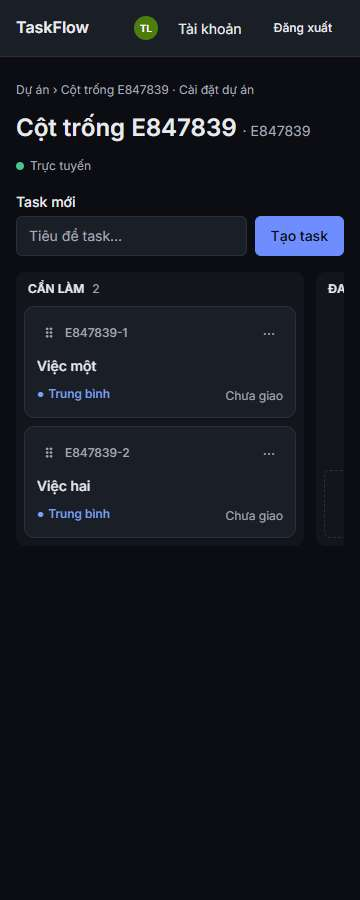
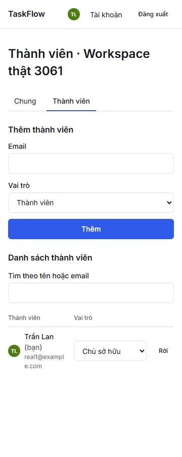
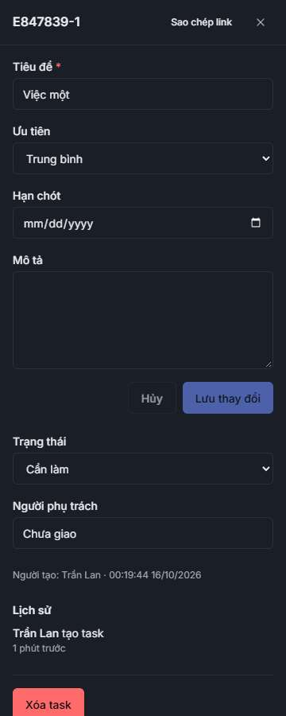
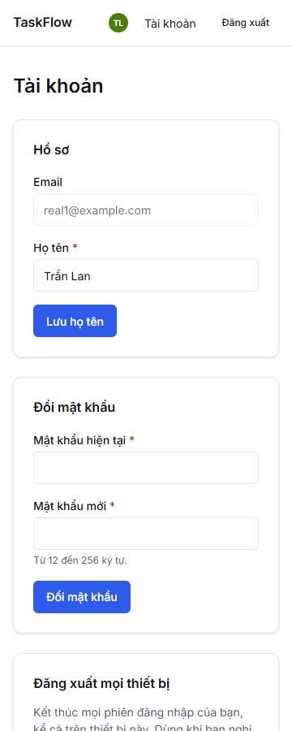
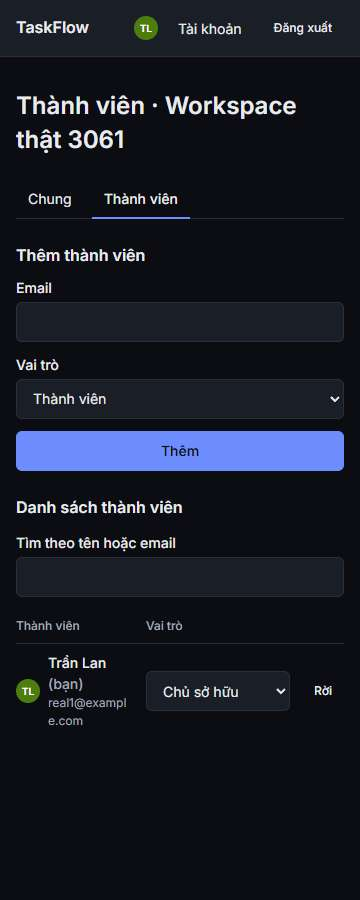
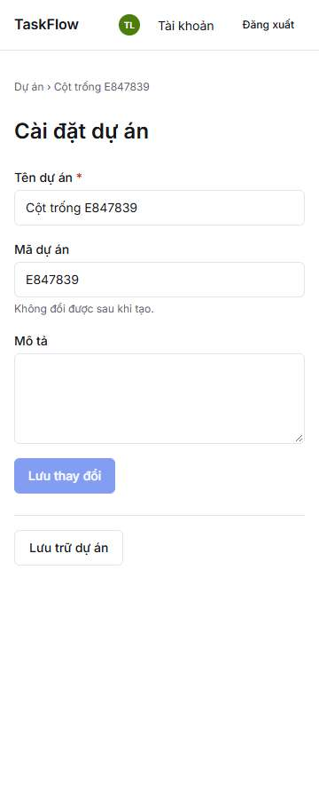
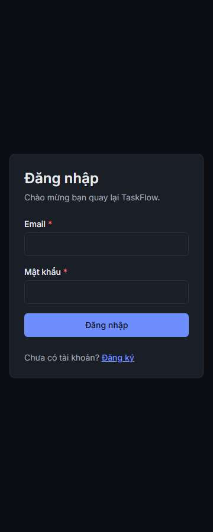
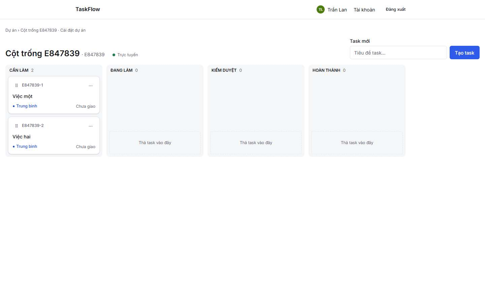
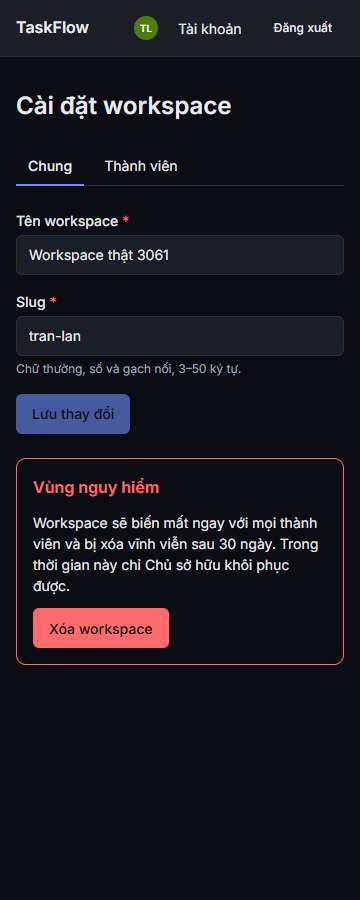
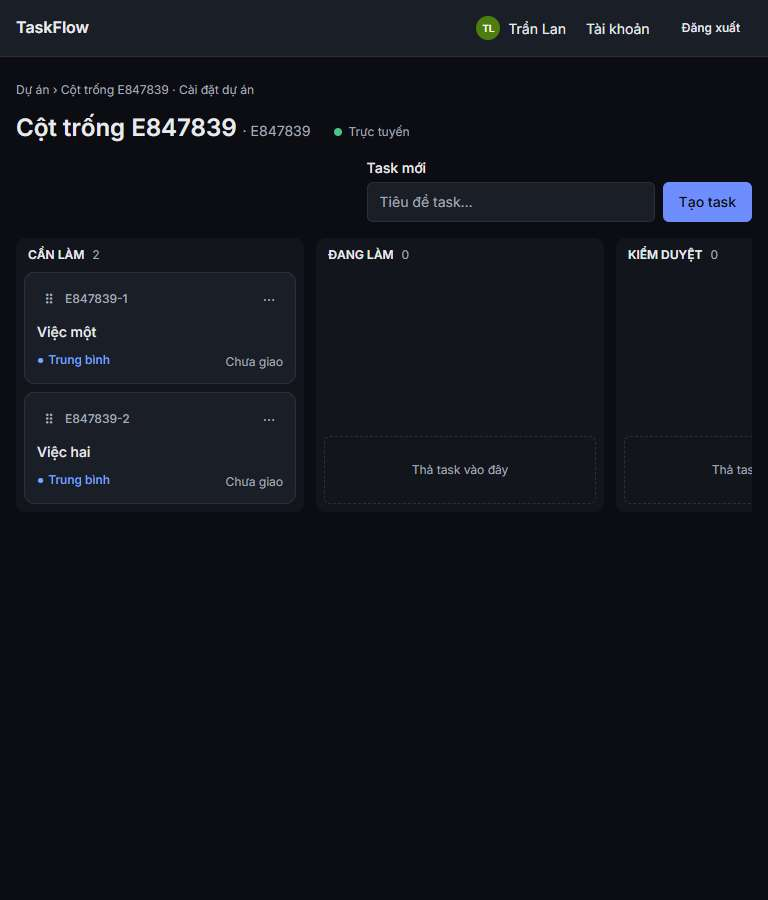

# E3 — Báo cáo: responsive, dark mode, trạng thái loading/empty/error

**Người làm:** Engineer E (`taskflow-enterprise-54`) · **Branch:** `feat/E3-ui-polish` (rebase trên main `5786775`) · **Ngày:** 2026-10-15/16
Gồm thêm G1 W1–W3 của A (refresh đang bay không đặt lại token sau `end()`; 2 comment).

## 1. Đã làm
| # | Chỗ lệch (frontend.md §1.2 / responsive) | Sửa |
|---|---|---|
| 1 | `/account`: `/auth/me` lỗi ⇒ skeleton hồ sơ hiện mãi | `EmptyState` "Không tải được hồ sơ" + **Thử lại** |
| 2 | Cài đặt dự án: không có trạng thái lỗi ngoài 404 | `EmptyState` "Không tải được dự án" + **Thử lại** (chỉ khi chưa có dữ liệu — refetch nền lỗi không che form) |
| 3 | 360px: form tạo nhanh (ô 18rem + nút > 328px) | ô co theo chỗ còn lại dưới `sm`, khe toolbar full-width trên mobile |
| 4 | 360px: bảng thành viên đẩy cả trang | bảng cuộn trong khung riêng (`overflow-x-auto`) |
| 5 | 360px (thấy khi kiểm trực quan): ô vai trò bị bóp còn ~115px ("Chủ sở hữ…") | `min-w-36` cho ô vai trò |
| 6 | 360px (thấy khi kiểm trực quan): nút Rời/Xóa bị đẩy ra ngoài khung | email được xuống dòng (`break-all`) ⇒ cả hàng vừa 328px |

Test: `test/error-states.test.tsx` (MSW 5xx ×3 — vượt retry — ⇒ khối lỗi ⇒ Thử lại ⇒ form) cho #1, #2; hạ tầng test: `startMockApi().server` để chèn lỗi một lần, harness có route `/account`.

Rà tĩnh: không còn màu viết cứng ngoài chữ trắng trên avatar (nền màu theo hash, đủ tương phản cả hai theme) — dark mode đi qua token; drawer full-width < md / 480px từ md; dialog `calc(100vw-2rem)`, tối đa `max-w-md`; header ẩn tên người dùng dưới `sm`.

## 2. Kiểm trực quan (build prod, Chrome thật qua CDP, API thật)
Script: 9 màn (chọn workspace, dự án, board, drawer `?task=`, cài đặt workspace, thành viên, cài đặt dự án, tài khoản, đăng nhập) × 360/768/1440px × sáng/tối = **54 lượt**; đo `scrollWidth > innerWidth` và liệt kê phần tử vượt mép phải (bỏ qua phần tử trong vùng cuộn ngang có chủ đích, như các cột board).

| Lượt | Kết quả |
|---|---|
| Lần 1 (trước #5, #6) | 54/54 không tràn ngang trang; nhìn ảnh thấy #5 |
| Sau #5 | thấy #6 (nút Rời phải cuộn ngang trong bảng mới thấy) |
| Sau #6 (màn Thành viên × 6) | 6/6 không tràn; ảnh: vai trò đọc đủ, nút Rời trong khung |

Ảnh (thư mục `E3/`):

| 360px tối | 360px sáng |
|---|---|
|  |  |
|  |  |
|  |  |
|  |  |
|  |  |

Ghi chú: ô ngày trong drawer hiện `mm/dd/yyyy` vì Chrome headless chạy locale en-US; trình duyệt tiếng Việt hiện `dd/mm/yyyy` (input gốc). Lượt chụp lại thứ 2 chạm **rate limit refresh** sau ~20 lần tải trang liên tiếp bằng cùng cookie (đúng thiết kế) ⇒ lượt cuối chỉ chụp lại màn Thành viên.

## 3. Ngoài phạm vi / còn mở
- **Bộ chọn theme Sáng/Tối/Hệ thống** (frontend.md §6.1, script đặt `data-theme` trước khi paint) **chưa có** — app theo `prefers-color-scheme` của hệ điều hành (globals.css ghi "Phase 4"). Dark mode tự nó đúng (ảnh trên); bộ chọn là tính năng mới ⇒ đề xuất ticket riêng.
- Đếm ngược `RATE_LIMITED` ở login (G2 F1) đã merge riêng (`1c5f28d`), có test MSW; ảnh login trên là trạng thái thường.

## 4. Definition of Done
```
$ pnpm verify                         → exit 0 (lint 0 · typecheck 0 · test 170 file / 1694 test 0, 0 "Unhandled" · audit 0)
$ pnpm --filter @taskflow/web build   → exit 0
$ playwright test (cả bộ ×1, build prod của 59d41ce, 1 worker) → 33 passed, 2 skipped (fixme có nhãn E2E-12b, E2E-16), 0 failed, exit 0
```
Hook pre-commit đầy đủ mọi commit.
